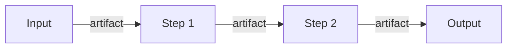

# RepoPilot Technical Report Writing Guide

**Applies to:** every technical report the RepoPilot team writes: research reports for the five assignments, design proposals, and later experiment reports
**Team:** Farag · Maro · Ziad · Omar · Hussein
**Document:** Deliverable 2 of 2, version 1.0 (modified), 14 October 2026
**Basis:** *A Guide to Technical Report Writing*, The Institution of Engineering and Technology (IET), 2015, hosted by IEEE IAS [1]

---

## Summary

This guide gives the five of us one report schema, so that our reports can be compared side by side and merged later into the capstone document. It applies the IET guide's principles: the reader comes first; reports are short and organised for the user; references are exact; writing is accurate and plain; diagrams are in the right place; there is a summary; and reports are checked before release [1]. On top of these it adds conventions the team needs: a fixed section order; labels that separate literature findings from design choices, implementation details and recommendations; rules for evidence, assumptions and reproducibility; and rules for drafting with AI tools. A quality checklist and a fill-in template are included, so this file is all a team member needs.

---

## Contents

1. Purpose and Status of This Guide
2. What the IET Guide Says (and What It Does Not)
3. The Report Schema
4. Separating Literature, Design, Implementation and Recommendations
5. Technical Depth, Evidence and Citations
6. Assumptions, Limitations and Reproducibility
7. Figures and Tables
8. Writing Style
9. Using AI Tools to Draft
10. Quality-Control Checklist
11. File Naming and Versions
12. References

Appendix A: Fill-in Report Template
Appendix B: Before-and-After Examples

---

## 1. Purpose and Status of This Guide

- **Reader of our reports:** first, the other four team members; then the supervisor. Assume the reader knows what RepoPilot is but has not read your sources.
- **Status of the rules:**
  - Rules marked **[IET]** restate the IET guide, with a page reference.
  - Rules marked **[Team]** are our own conventions, adopted for consistency.
  - The IET guide itself says there are "no absolute rules about the details of report production" and that its laws may be broken if necessary [1, p.3]. Our [Team] rules are binding inside the team so that the reports match.
- **Access note:** the linked IET PDF (18 pages) was retrieved and read in full when this guide was written. If the link changes, check this guide against the current version.

---

## 2. What the IET Guide Says (and What It Does Not)

### 2.1 The ten laws [IET, p.3, p.17]

| # | Law | How we apply it |
|---|---|---|
| 1 | The reader is the most important person. | Write for a teammate who has not read your sources. |
| 2 | Keep the report as short as possible. | Main text about 6–12 pages; detail goes to appendices [1, p.5]. |
| 3 | Organise for the convenience of the report user. | Users read the beginning, then the end, then the section they need [1, p.6], so each section must stand on its own. |
| 4 | All references should be correct in all details. | Every source verified; one consistent style [1, p.8]. |
| 5 | The writing should be accurate, concise and unobtrusive. | Plain formal English (Section 8). |
| 6 | The right diagram, with the right labels, in the right place. | Figures next to the text that uses them [1, p.12]. |
| 7 | Summaries give the whole picture, in miniature. | Summary of at most 250 words [1, p.14]. |
| 8 | Check for technical errors, typing errors and inconsistency. | Checklist in Section 10. |
| 9 | The report should look as good as it is. | Consistent layout, numbering and spacing. |
| 10 | The reader is the most important person. | Repeated on purpose: never break it [1, p.3, p.16]. |

### 2.2 Specific IET points we adopt

- Long-report format: Title page, Acknowledgements, Summary, Contents, Introduction/Terms of reference/Scope, Procedure, Findings, Conclusions, Recommendations, References/Bibliography, Appendices. The IET says to adapt or merge these sections to suit the reader [1, p.6].
- Decimal heading notation, normally at most four levels; appendices lettered (Appendix B2.4) [1, p.7].
- References either numbered in square brackets and listed in order, or Harvard style. **Consistency matters most** [1, p.7–8].
- Online sources cited with the URL and the date consulted [1, p.8].
- Diagrams numbered by section (Figure 3.7 = seventh diagram in Section 3), referred to in the text, with titles always in the same position relative to the diagram [1, p.13].
- Do not rely on colour alone; it is lost in black-and-white copies [1, p.12].
- The summary is written last, in continuous prose, usually no more than 250 words for a report of up to 50 pages [1, p.14].
- Title page: title, author, reference number, date and classification; no summary on the title page [1, p.15].
- Page numbers such as "page 15 of 18" [1, p.15].
- Ideally two checkers: a technical expert and a careful non-expert. Leave 48 hours, or better a week, before checking [1, p.15].

### 2.3 What the IET guide does **not** prescribe

The IET guide does not fix a citation style (it shows both numbered and Harvard examples), fonts, margins, caption placement (only that it is consistent), or a page limit. It also does not cover AI-assisted writing or software-specific content such as schemas and reproducibility. Where this guide sets these, the rule is marked **[Team]**.

---

## 3. The Report Schema

**[Team]** Use these headings, numbers and order. Optional items are marked. The structure adapts the IET long-report format [1, p.6] to a design-research report.

| # | Section | What belongs here | What does **not** belong here | Guide length |
|---|---|---|---|---|
| — | **Title page** | Specific title, author, assignment ID (A1–A5), report ID, version, date, reviewers | Summary, distribution list | ½ page |
| — | **Summary** | Question, approach, key findings with numbers, main recommendation. Prose only. | Citations, lists, figures, anything not in the body | ≤ 250 words |
| — | **Contents** | Headings to level 2, with page numbers | — | auto |
| — | **Abbreviations** *(optional)* | Alphabetical list; required if more than 5 | — | — |
| 1 | **Introduction** | 1.1 Objective (the one question); 1.2 Scope (in/out); 1.3 Place in RepoPilot (stage, upstream and downstream assignments) | Background theory | ½–1 page |
| 2 | **Background and Literature Findings** | What sources report that matters for the question, each item tied to our problem and labelled **[LIT]** | Our opinions; a literature dump | 1–2 pages |
| 3 | **Procedure** | How you investigated: sources searched, documents read, comparisons made, criteria used, and what you could not access | Results | ½ page |
| 4 | **Proposed Design** | **4.1 Inputs**, **4.2 Process** (with a figure), **4.3 Outputs** (with schema sketches), **4.4 Context-window and cost considerations**, **4.5 Integration points**. Labelled **[DESIGN]**; any concrete technology or configuration labelled **[IMPL]**. | Untested claims stated as fact | 3–5 pages |
| 5 | **Options Analysis** | Each decision: options, criteria, trade-offs, evidence, and the chosen or preferred option with its reason | New design not explained in Section 4 | 1–2 pages |
| 6 | **Validation Plan** | How the choice will be tested later: metric, data, baseline, control, number of runs, pass criterion | Results that do not yet exist | ½–1 page |
| 7 | **Assumptions, Limitations and Risks** | Each assumption, limitation and risk, with impact and mitigation | — | ½ page |
| 8 | **Conclusions** | What the findings mean. No new information. | Recommendations, new data | ½ page |
| 9 | **Recommendations** | Numbered, actionable, labelled **[REC]**, each pointing back to evidence | Unsupported wishes | ½ page |
| 10 | **Open Questions for the Team** | Decisions the team must take, with the options | — | ¼ page |
| 11 | **References** | Every cited source, verified, in one style | Sources not cited in the text | — |
| A… | **Appendices** | Long tables, full schemas, extra notes | Material the main argument needs (put it in the body) | as needed |

**Notes**

- **[IET]** Start writing with the factual material (findings) and write the summary last [1, p.6–7, p.14].
- **[IET]** Conclusions and recommendations are separate sections [1, p.6]. Conclusions say what is true; recommendations say what to do.
- **[Team]** Section 4.1–4.3 (inputs → process → outputs) is what the team decision session compares across assignments. Name every artifact exactly as in the work plan.

---

## 4. Separating Literature, Design, Implementation and Recommendations

**[Team]** Readers must always be able to tell where a statement comes from. Put these labels at the start of the sentence, bullet or table row where the type is not obvious from the section:

| Label | Meaning | Must include | Example |
|---|---|---|---|
| **[LIT]** | A finding reported by a source | Citation with page, section, table or figure | [LIT] A randomly retrieved fix scored below no retrieval (52.98 vs 53.46 EM) [3, p.10, Table 7]. |
| **[DESIGN]** | Our proposed structure or method, independent of specific tools | Rationale linked to [LIT] or to a requirement | [DESIGN] Retrieve one verified pattern per repair attempt. |
| **[IMPL]** | A concrete technology, library, configuration or parameter | Why this one; alternatives; "to verify" if not checked in docs | [IMPL] Candidate: a BM25 library plus a dense embedding model (to verify licence and cost). |
| **[REC]** | An action we propose the team takes | Numbered; points to supporting sections | [REC] R2: compare pattern retrieval against "no retrieval" before adopting it (Sections 2.3, 6). |
| **[ASSUMPTION]** | Something taken as true without verification | Why it is reasonable; what would change if false | [ASSUMPTION] Typical apps are under 100k tokens; unmeasured. |
| **[OPEN]** | An unresolved question | Who decides; by when | [OPEN] Is the VibeVulns dataset publicly released? |

**Rules**

1. A [LIT] statement without a precise locator is not allowed.
2. Never turn [LIT] into [DESIGN] silently. Write: "[LIT] TestAgent reports 83.69% mutation score on Java projects [5, p.5]. [ASSUMPTION] Results on JavaScript apps may differ; see Section 6."
3. When the source is a **team summary** rather than the original paper, say so: "[LIT] (via Hussein's summary [4, p.8])". Prefer the original paper when it is available.

---

## 5. Technical Depth, Evidence and Citations

### 5.1 Expected depth

A design-research report is deep enough when a teammate could start implementing from it without asking you basic questions. For each component this means:

- the **inputs and outputs**, with field-level schema sketches;
- the **process**, as numbered steps plus a diagram;
- at least **two credible alternatives** compared on stated criteria;
- **cost and context implications** (model calls, approximate tokens, time);
- **failure handling**: what happens when a step fails, times out or produces low-confidence output;
- the **validation plan** that would show the design works.

### 5.2 Evidence hierarchy (strongest first)

1. Reproducible measurement by the team (later phases).
2. Peer-reviewed paper, original read, with an exact locator.
3. Preprint, original read, with an exact locator.
4. Official tool documentation (version and date accessed).
5. Team summary of a paper (mark as second-hand).
6. Blog posts or forum answers (avoid; only for "how to" detail, never for performance claims).

Self-reported or single-run results should be flagged as such when used.

### 5.3 Citations

- **[Team]** We use **IEEE-style numbered citations** [n], in order of first use. The IET guide accepts numbered or Harvard style; we pick numbered for consistency [1, p.7–8].
- **[Team]** Every citation of a factual claim carries a locator: `[3, p.10, Table 7]`, `[2, §6.2]`, `[4, slide 8]`.
- **[IET]** Online sources include the URL and the date accessed [1, p.8].
- **Formats:**
  - Conference: `[n] A. Author, B. Author, and C. Author, "Title," in Proc. Venue, Year, pp. x–y, doi: ….`
  - Preprint: `[n] A. Author et al., "Title," arXiv:XXXX.XXXXX, Year.`
  - Documentation: `[n] Vendor, "Page title," Documentation. [Online]. Available: URL (accessed Mon. DD, YYYY).`
  - Internal: `[n] Team RepoPilot, "Title," internal document, file name, Year.`
- **[Team]** A fabricated or unverified reference is the most serious error a report can contain.

---

## 6. Assumptions, Limitations and Reproducibility

- **Assumptions:** list each one in Section 7 with its impact if wrong. Mark it inline with [ASSUMPTION].
- **Limitations:** state what you did not cover, could not access, or only read second-hand. Name the files.
- **Reproducibility [Team]:** a reader must be able to repeat your investigation. Record:
  - the sources and versions read (paper version, documentation version, date accessed);
  - search terms or places you looked;
  - the exact criteria used to compare options;
  - for later experiment reports: commit SHA, tool versions, model names and versions, prompts (in an appendix), random seeds, number of runs, and the raw-results location.
- **Never report a number you cannot trace** to a source or a log.

---

## 7. Figures and Tables

- **[IET]** Place each figure or table where the reader needs it, not all in an appendix [1, p.12].
- **[IET]** Number by section (Figure 4.1, Table 5.2) and refer to every one in the text [1, p.13].
- **[IET]** Keep titles in the same position for every diagram [1, p.13]. **[Team]** Figure captions go below the figure; table captions go above the table.
- **[IET]** Label axes and units; use the same scale for compared graphs; keep labels horizontal [1, p.12–13].
- **[IET]** Do not depend on colour alone [1, p.12].
- **[IET]** Use tables for many exact figures, bar charts for comparisons, graphs for trends [1, p.12]. Put units in column headings and round to sensible precision [1, p.12–13].
- **[Team]** Section 4.2 must contain an architecture or flow diagram. Label every arrow with the artifact it carries. Keep the editable source (Mermaid, draw.io or Excalidraw) next to the report.
- **[Team]** Figures adapted from a paper say so in the caption: "Adapted from [3, Fig. 2]."
- **[IET]** Before keeping a diagram, ask: does it give the required information, is it accurate, is it easy to use, and does it look tidy [1, p.13]?

---

## 8. Writing Style

These rules apply the IET guide's Section 3 [1, p.9–11].

- **Accurate.** Say exactly what you mean. Spell-checkers miss real-but-wrong words such as *not*/*now* and *form*/*from* [1, p.9]. Check commas that change meaning [1, p.9].
- **Concise.** Cut filler: "at this present moment in time" → "now" [1, p.10]. Vary sentence length and avoid sentences longer than about three lines. One idea per paragraph.
- **Unobtrusive.** Formal but plain: no contractions or slang, and no pompous words ("use", not "utilise") [1, p.10].
- **Active voice where possible:** "We recommend…" rather than "It is recommended that…" [1, p.10].
- **Avoid vague words** such as *basically, quite, rather, fairly, in due course* [1, p.10]. **[Team]** Also avoid *robust, seamless, cutting-edge, leverage, state-of-the-art* unless you give the evidence.
- **[Team] One term per concept.** Use the artifact names and verdict labels from the work plan exactly (`failure_verdict`, `test_wrong`, …).
- **[IET]** Define abbreviations and provide a list [1, p.5–6].
- **[Team]** Put code identifiers, file names and commands in `monospace`.

---

## 9. Using AI Tools to Draft

AI drafting is allowed. The author remains fully responsible for every sentence.

1. **Give the tool this guide and the template** (Appendix A) plus your own notes and source excerpts. Use the prompt below.
2. **Allow no invented facts.** The tool must write `[CITATION NEEDED]` or `[TO VERIFY]` rather than invent a source, number, API or tool feature.
3. **Verify every citation and number yourself** against the original file and page.
4. **Keep the schema.** Headings, numbering, order and labels are not negotiable.
5. **Remove generic filler** that is not about RepoPilot.
6. **Disclose AI use** in one sentence under Procedure ("Drafting assisted by an AI tool; all sources and numbers verified by the author").
7. **Be able to defend every sentence** in the decision session.

**Prompt to paste into your AI tool:**

```text
Help me write an internal technical report for the capstone project RepoPilot, an
evidence-driven multi-agent framework for automated QA and repair of AI-generated
repositories (first target stack: React/Vite + Supabase + Stripe).

Follow the attached template and writing guide EXACTLY:
- Keep every heading, number and order. Do not add, remove or rename level-1 sections.
- Label statements with [LIT], [DESIGN], [IMPL], [REC], [ASSUMPTION] or [OPEN] as defined
  in the guide. Every [LIT] needs a citation with a page/section/table locator.
- Use ONLY the sources I provide. If a claim needs a source I did not give, write
  [CITATION NEEDED]. If a fact, number, API or tool feature is uncertain, write [TO VERIFY].
  Never invent references, numbers or results.
- IEEE-style numbered citations [n] in order of first use.
- Summary: at most 250 words, continuous prose, no citations or lists, includes the
  main recommendation.
- Formal, plain English; active voice; short sentences; no filler or marketing words;
  no contractions; the same term for the same concept throughout.
- Figures and tables numbered by section (Figure 4.1, Table 5.1), each referred to in the
  text before it appears; figure captions below, table captions above. Give diagrams as
  Mermaid code.
- Conclusions contain no new information; Recommendations are numbered R1, R2, ...

My assignment: <A1–A5 and title>
My notes and source excerpts (with file names and pages):
<paste here>
```

Before submitting, search for `[CITATION NEEDED]` and `[TO VERIFY]`. None may remain.

---

## 10. Quality-Control Checklist

Tick every item before submitting. **[IET]** Ideally a second person checks too, one with technical knowledge and one without, after a break of at least 48 hours [1, p.15].

**Structure**
- [ ] All schema sections present, in order, with the exact headings (Section 3).
- [ ] Section 4 has 4.1 Inputs, 4.2 Process (with a figure), 4.3 Outputs (with schema sketches), 4.4 Context and cost, 4.5 Integration.
- [ ] Options Analysis compares at least two alternatives on stated criteria.
- [ ] Validation Plan states metric, data, baseline or control, runs, and pass criterion.
- [ ] Summary ≤ 250 words, prose, contains the recommendation; no summary on the title page.
- [ ] Conclusions add nothing new; Recommendations numbered and actionable.

**Evidence**
- [ ] Every [LIT] has a citation with a locator; second-hand sources marked.
- [ ] Every number checked digit by digit against its source [1, p.15].
- [ ] Every reference opened and verified; online sources have URL and access date.
- [ ] No `[CITATION NEEDED]` or `[TO VERIFY]` left.
- [ ] Assumptions, limitations and unavailable materials listed.

**Consistency and presentation**
- [ ] Same term for the same concept; artifact names match the work plan.
- [ ] Abbreviations defined and listed.
- [ ] Figures and tables numbered by section, captioned consistently, referred to in the text, and readable in black and white.
- [ ] Headings use decimal numbering (at most four levels); appendices lettered.
- [ ] Page numbers "Page X of Y"; title page complete.
- [ ] Spell-check run plus a human read-through.

**AI use**
- [ ] AI use disclosed in Procedure; every sentence understood and defensible by the author.

---

## 11. File Naming and Versions

**[Team]**
- File name: `RP-<A#>-<ShortTitle>-v<major>.<minor>.pdf`, for example `RP-A1-Repo-Access-and-RAG-v1.0.pdf`.
- Report ID on the title page = file name without the version.
- v0.x = draft; v1.0 = submitted for the decision session; v1.x = revised after it.
- Keep the editable source (Markdown/Word/Docs) and the figure sources together in the shared folder.

---

## 12. References

[1] The Institution of Engineering and Technology, *A Guide to Technical Report Writing*, J. van Emden and J. Easteal, rev. A. Kerr. Stevenage, U.K.: IET, 2015. [Online]. Available: https://ias.ieee.org/wp-content/uploads/2023/06/2020-01-16_IET_Technical_Report_Writing_Guidelines.pdf (accessed Oct. 14, 2026).

*References [2]–[5] in the examples above are placeholders that show the format. Each report has its own list.*

---

## Appendix A: Fill-in Report Template

Copy everything below into a new file. Replace `<…>` and delete the guidance comments.

````markdown
# <Specific title, e.g. "Repository Access and Hybrid Retrieval Design for RepoPilot">

| | |
|---|---|
| **Project** | RepoPilot: Evidence-Driven Multi-Agent QA and Repair |
| **Assignment** | <A1–A5> – <assignment title> |
| **Author** | <Name> |
| **Report ID** | RP-<A#>-<ShortTitle> |
| **Version / Date** | <v1.0> / <DD Month YYYY> |
| **Reviewed by** | <technical checker>, <non-expert checker> |

## Summary
<!-- ≤ 250 words, prose only, no citations. Question → approach → key findings → main recommendation. Write last. -->

## Contents
<!-- Levels 1–2 with page numbers. -->

## Abbreviations
<!-- Optional; required if more than 5. -->
| Abbreviation | Meaning |
|---|---|

## 1. Introduction
### 1.1 Objective
<!-- The one question this report answers. -->
### 1.2 Scope
<!-- In scope / out of scope. -->
### 1.3 Place in RepoPilot
<!-- Pipeline stage(s); upstream and downstream assignments. -->

## 2. Background and Literature Findings
<!-- Each point labelled [LIT] with a precise citation, and tied to our question. Mark second-hand sources. -->
### 2.1 <Topic>
### 2.2 <Topic>

## 3. Procedure
<!-- Sources searched and read (with versions/dates), comparison criteria, what you could not access, AI-use disclosure. -->

## 4. Proposed Design
### 4.1 Inputs
Table 4.1 lists the inputs.

**Table 4.1** Inputs to <component>

| Input | Format | Source (assignment/user) | Required? |
|---|---|---|---|

### 4.2 Process
Figure 4.1 shows the process.


**Figure 4.1** <Specific caption>

#### 4.2.1 <Step> 
<!-- [DESIGN] what and why; [IMPL] candidate technology and why; failure handling. -->

### 4.3 Outputs
**Table 4.2** Outputs of <component>

| Artifact | Format | Consumer | Purpose |
|---|---|---|---|

```json
{
  "schema_version": "0.1",
  "run_id": "<string>",
  "commit_sha": "<string>",
  "created_by": "<agent>",
  "<field>": "<type – meaning>"
}
```

### 4.4 Context-Window and Cost Considerations
<!-- What enters each model call, approximate tokens, number of calls per app, budget and limits. -->

### 4.5 Integration Points
<!-- What you need from whom; who depends on you; requested changes to others' artifacts. -->

## 5. Options Analysis
**Table 5.1** Options for <decision>

| Option | <Criterion 1> | <Criterion 2> | <Criterion 3> | Evidence | Verdict and reason |
|---|---|---|---|---|---|

## 6. Validation Plan
**Table 6.1** Validation of <decision>

| Question | Metric | Data | Baseline/control | Runs | Pass criterion |
|---|---|---|---|---|---|

## 7. Assumptions, Limitations and Risks
| # | Type (assumption/limitation/risk) | Description | Impact | Mitigation |
|---|---|---|---|---|

## 8. Conclusions
<!-- Meaning of the findings. No new information. -->

## 9. Recommendations
- **[REC] R1.** <Action>, because <reason> (Section n).
- **[REC] R2.** <…>

## 10. Open Questions for the Team
| # | Question | Options | Who decides |
|---|---|---|---|

## 11. References
[1] <IEEE style, verified, with locator-ready details>

## Appendix A: <Title>
````

---

## Appendix B: Before-and-After Examples

| Problem | Before | After |
|---|---|---|
| Unlabelled source | "Hybrid retrieval is better." | "[LIT] Hybrid BM25 + dense retrieval reached 54.15 EM vs 53.93 for dense only on TFix [3, p.10, Table 7]." |
| Literature becomes design silently | "TestAgent gets 83% mutation, so we will too." | "[LIT] TestAgent reports 83.69% on Java projects [5, p.5]. [ASSUMPTION] JavaScript results may differ; see Section 6." |
| Vague and wordy | "Basically, we will leverage a quite robust RAG in a seamless way." | "[DESIGN] Agents call a retrieval tool that combines keyword and embedding search (Section 4.2.2)." |
| Untraceable number | "Apps are about 8k lines." | "[LIT] The median app has 8,254 LoC in 100 files [2, p.5, §4]." |
| Conclusion with new data | "In conclusion, we also tested LanceDB and it was fast." | Move to Options Analysis; the conclusion interprets only. |
| Unspecific heading | "4.3 Other Stuff" | "4.3 Outputs: `risk_map` and `test_plan`" |
| Inconsistent terms | "verdict" … "label" … "classification" | "verdict" everywhere |
| Undefined abbreviation | "We check RLS." | "We check Row-Level Security (RLS)." |
