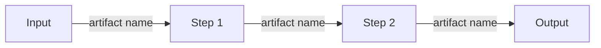

<!--
RepoPilot technical report template v1.0
Follow 02_Technical_Report_Writing_Guide.md. Keep every heading, number and order.
Replace everything in <angle brackets>. Delete these comments before export.
-->

# <Specific Title, e.g. "Repository Ingestion and Hybrid Code Retrieval for RepoPilot">

| | |
|---|---|
| **Project** | RepoPilot: Evidence-Driven Multi-Agent QA and Repair |
| **Workstream** | <WS1 / WS2 / WS3 / WS4> – <workstream title> |
| **Author** | <Name> |
| **Report ID** | RP-<WS>-<ShortTitle> |
| **Version** | <v0.1 draft / v1.0 submitted> |
| **Date** | <DD Month YYYY> |
| **Reviewed by** | <technical checker>, <non-expert checker> |

<div style="page-break-after: always;"></div>

## Summary

<!-- ≤ 250 words, continuous prose, no lists, no figures, no citations. Write it LAST.
Cover: the question, the approach chosen, the key findings with numbers, the recommendation. -->

<...>

<div style="page-break-after: always;"></div>

## Table of Contents

<!-- Generate automatically if your editor supports it. Down to level 2. -->

## List of Abbreviations

<!-- Optional; required if more than 5 abbreviations. Alphabetical. -->

| Abbreviation | Meaning |
|---|---|
| <RAG> | <Retrieval-Augmented Generation> |

---

## 1. Introduction

### 1.1 Objective
<!-- The single question this report answers. One or two sentences. -->

### 1.2 Scope
<!-- What is covered and what is explicitly not covered. -->

### 1.3 Context within RepoPilot
<!-- Which pipeline stage(s), which agents, which workstreams sit before and after you. -->

## 2. Background

<!-- Only what the reader needs. Each concept or paper is tied to our problem.
Cite original papers [n]. Mark paper claims vs our inferences clearly. -->

### 2.1 <Concept or paper group>

### 2.2 <Concept or paper group>

## 3. Procedure / Method

<!-- What you read, what you tried, on which sample app (name + commit), what you measured,
which tool versions. Enough for a teammate to repeat it. -->

## 4. Proposed Design

### 4.1 Inputs

<!-- Table 4.1 is mandatory. -->

Table 4.1 lists the inputs this component requires.

**Table 4.1** Inputs required by <component>

| Input | Format | Source (workstream / user) | Required or optional |
|---|---|---|---|
| <repo_profile.json> | <JSON, schema v0> | <WS1> | <Required> |

### 4.2 Process

Figure 4.1 shows the proposed pipeline.



**Figure 4.1** <Specific caption, e.g. "Proposed ingestion and indexing pipeline">

#### 4.2.1 <Step 1 name>
<!-- What it does, tool/model/algorithm used, why, configuration. -->

#### 4.2.2 <Step 2 name>

### 4.3 Outputs

**Table 4.2** Outputs produced by <component>

| Output artifact | Format | Consumer (workstream / agent) | Purpose |
|---|---|---|---|
| <risk_map.json> | <JSON> | <WS2 planner, WS4 report> | <...> |

Schema sketch for <main artifact>:

```json
{
  "schema_version": "0.1",
  "run_id": "<...>",
  "commit_sha": "<...>",
  "created_by": "<agent name>",
  "<field>": "<type and meaning>"
}
```

### 4.4 Context-Window and Cost Considerations

<!-- Which model(s), how many tokens per call, how many calls per app, what goes into the
context and what is retrieved on demand, estimated cost per app, budgets and limits. -->

### 4.5 Integration Points

<!-- Which other workstreams you depend on (and for what), and which depend on you.
List any change you need in another workstream's artifact. -->

## 5. Findings / Results

<!-- Evidence only: spike results, measurements, tool comparisons, supporting numbers
from papers (with citations). Use tables and figures numbered 5.x. -->

## 6. Alternatives Considered

**Table 6.1** Comparison of options for <decision>

| Option | <Criterion 1> | <Criterion 2> | <Criterion 3> | Decision and reason |
|---|---|---|---|---|
| <Option A> | | | | <Chosen: ...> |
| <Option B> | | | | <Rejected: ...> |

## 7. Risks and Open Questions

| # | Risk or open question | Impact | Proposed mitigation / who decides |
|---|---|---|---|
| Q1 | <...> | <High/Med/Low> | <...> |

## 8. Conclusions

<!-- What the findings mean. NO new information. Each point follows from Sections 4–6. -->

## 9. Recommendations

<!-- Numbered and actionable. -->

- **R1.** <Do X for Y, because Z (Section n).>
- **R2.** <...>

## 10. References

<!-- IEEE numeric style, in order of first citation. Every entry verified. -->

[1] <A. Author, B. Author, and C. Author, "Title," in *Proc. Venue*, Year, pp. x–y.>
[2] <Tool, "Page title," Docs. [Online]. Available: URL (accessed Mon. DD, YYYY).>

---

## Appendix A: <Title, e.g. Full Artifact Schemas>

### A.1 <...>

## Appendix B: <Title, e.g. Raw Spike Logs>
