# Reproducible Benchmarking and Evidence-Based Evaluation for RepoPilot

| | |
|---|---|
| **Project** | RepoPilot: Evidence-Driven Multi-Agent QA and Repair |
| **Workstream** | WS5 – Benchmark, Evaluation Dataset and Baselines |
| **Author** | Abdalrahman Hussein |
| **Report ID** | RP-WS5-Benchmark-Evaluation |
| **Version** | v0.1 – revised research and design draft |
| **Date** | 14 October 2026 |
| **Reviewed by** | --- |

<div style="page-break-after: always;"></div>

## Summary

RepoPilot needs a benchmark that distinguishes genuine software defects from incorrect generated tests, unreliable environments and unverified agent claims. WS5 proposes a reproducible and leakage-controlled evaluation of its multi-agent quality-assurance and repair pipeline on AI-generated React/Vite applications integrating Supabase and, where relevant, Stripe. The design combines pinned application revisions, preserved intent evidence, independently verified seeded and natural bugs, blind four-class failure annotation, a deterministic experiment runner, and matched baselines. The proposed initial corpus contains 8–12 eligible applications, with a preferred 12-app split of six development and six held-out applications; both sizes are planning targets, not collected datasets. Each configuration receives at least three repeated runs. The principal comparisons are full RepoPilot versus a general-purpose coding agent and intent-aware versus code-only failure attribution, supported by component ablations. Outcomes measure independently confirmed defect detection, safe repair, attribution, regression safety, cost, and time. Published studies motivate the design, but no RepoPilot benchmark applications, ground-truth labels, or experimental results have been verified for this report. WS5 should first agree on schemas, evaluation questions, and success gates with WS4; then reproduce a small application pilot with WS2 before freezing the held-out data and claiming improvements.

<div style="page-break-after: always;"></div>

## Table of Contents

1. [Introduction](#1-introduction): [1.1 Objective](#11-objective) · [1.2 Scope](#12-scope) · [1.3 Context within RepoPilot](#13-context-within-repopilot)
2. [Background](#2-background): [2.1 Why the benchmark must match the target stack](#21-why-the-benchmark-must-match-the-target-stack) · [2.2 Independent evidence and evaluation reliability](#22-independent-evidence-and-evaluation-reliability)
3. [Procedure / Method](#3-procedure--method)
4. [Proposed Design](#4-proposed-design): [4.1 Inputs](#41-inputs) · [4.2 Process](#42-process) · [4.3 Outputs](#43-outputs) · [4.4 Context-Window and Cost Considerations](#44-context-window-and-cost-considerations) · [4.5 Integration Points](#45-integration-points)
5. [Findings / Results](#5-findings--results)
6. [Alternatives Considered](#6-alternatives-considered)
7. [Risks and Open Questions](#7-risks-and-open-questions)
8. [Conclusions](#8-conclusions)
9. [Recommendations](#9-recommendations)
10. [References](#10-references)

[Appendix A: Artifact Schemas and Scoring Definitions](#appendix-a-artifact-schemas-and-scoring-definitions) · [Appendix B: Pilot Protocol and Audit Checklist](#appendix-b-pilot-protocol-and-audit-checklist)

## List of Abbreviations

| Abbreviation | Meaning |
|---|---|
| API | Application Programming Interface |
| CI | Continuous Integration |
| CLI | Command-Line Interface |
| ECE | Expected Calibration Error |
| JSON | JavaScript Object Notation |
| JSONL | JSON Lines |
| LLM | Large Language Model |
| OWASP | Open Worldwide Application Security Project |
| RAG | Retrieval-Augmented Generation |
| RLS | Row-Level Security |
| SARIF | Static Analysis Results Interchange Format |
| SHA | Secure Hash Algorithm (Git revision identifier context) |
| WS | Workstream |

---

## 1. Introduction

### 1.1 Objective

This report answers one question: **How should WS5 evaluate whether RepoPilot finds and safely repairs real defects in AI-generated applications more effectively than budget-matched alternatives?** The evaluation must also test whether independent evidence of intended behaviour improves the classification of failing generated tests [1].

Success is not equivalent to a passing test or a model-written completion message. The evaluator must determine whether a real defect existed, whether the system attributed a failure correctly, and whether an accepted patch restored the intended behaviour without weakening security or introducing regressions.

### 1.2 Scope

The design covers corpus selection and provenance, development/test partitioning, verified bug injection and natural-bug review, failure annotation, experiment baselines, component ablations, reproducible execution, stage and end-to-end metrics, uncertainty, cost, and release audits. The primary target is React/Vite applications backed by Supabase and, for payment workflows, Stripe. Other frameworks remain future external-validity tests.

This report **does not** implement WS1–WS4 agents, present benchmark runs as complete, claim unmeasured improvements, or set WS4's final research questions and acceptance thresholds. Security probes must use isolated local fixtures and test-mode payment services, never real user data or live third-party targets.

### 1.3 Context within RepoPilot

WS1 builds repository profiles, retrieval tools, and structural context. WS2 owns risk-guided test generation, sandbox execution, and coverage/mutation measurements. WS3 supplies static/security findings, repair proposals, and executable validation gates. WS4 orchestrates the pipeline, owns shared artifact schemas and the failure-attribution model, and decides the final evaluation protocol [1].

**WS5 evaluates the pipeline rather than controlling its verdicts.** Before a run, WS5 supplies pinned repositories, defect definitions, independent oracle tests, and split assignments. After a run, it collects `execution_result.json`, `failure_verdict.json`, `validation_report.json`, traces, and resource logs; an independent scorer computes outcomes. Its withheld labels, locations, and reference patches must never enter the evaluated agent's runtime context.

## 2. Background

### 2.1 Why the benchmark must match the target stack

Deng, Fan, and Meng collected **9,041** vibe-coded applications and audited **200** deployed examples. Their paper reports **1,186** validated vulnerabilities, with **91.0%** of those audited applications containing at least one vulnerability [2]. These are findings about the authors' sample, **not RepoPilot results**. The study identifies access-control, authentication, incomplete-change, and other security failures relevant to RepoPilot's intended environment. Its findings motivate tests of Supabase Row-Level Security (RLS), server-side access control, Stripe price integrity and webhook verification, exposed client-side secrets, and ordinary functional regressions.

**WS5 inference:** a benchmark based only on generated-test pass rates, patch similarity, or isolated toy functions would miss repository-level trust boundaries. An independent behavioural oracle must establish what should happen before judging whether the agent's test or the application is wrong.

Existing benchmark resources provide useful secondary checks. BugsJS offers **453** real, reproducible JavaScript bugs from **10** server-side projects [3]. OWASP Juice Shop is an intentionally vulnerable web application and can exercise security scanners, but its architecture differs from the proposed React/Vite/Supabase/Stripe corpus [4]. Neither should determine the primary headline score.

### 2.2 Independent evidence and evaluation reliability

The central distinction is between a **defect** and a **failed generated test**. A seeded defect is a reviewed, reversible code change, paired with a clean revision, independent intent source, and a test that fails on the buggy revision and passes on the clean revision. A natural defect needs a reproducer and human-confirmed intended behaviour. A failed generated test is a separate annotation case: the presence of a known seed alone does not prove the generated assertion is correct.

The vibe-coding security study reports Cohen's agreement statistic **κ = 0.87** for its own security reviewers and **123 of 560** repeated experimental cells (**22.0%**) with non-unanimous outcomes across three repeats [2]. These numbers justify investigating review consistency and stochastic variation; they do not establish WS5's future agreement or reliability. SGAgent reports **51.3%** repair accuracy in a specified SWE-bench-Lite configuration using Claude 3.5 [5]. TestGen-LLM reports that, in its own evaluation, **75%** of generated tests built, **57%** passed reliably, and **25%** increased coverage [6]. Neither result can be used as a RepoPilot prediction.

RAP-Gen demonstrates retrieval-based patch generation [7]. Its approach reinforces the need to keep held-out fixes out of repair-example retrieval. Public repair evaluations also face oracle quality and training-data contamination concerns documented in an analysis of SWE-bench Verified [8]. WS5 therefore needs frozen splits, withheld oracles, versioned pattern libraries, explicit run budgets, and an evaluation independent of the agent's self-report.

## 3. Procedure / Method

**Work completed for this report:** two candidate WS5 report drafts, the supplied template and writing guide, and the RepoPilot work-division plan were compared. The cited original research and benchmark documentation were checked for the key reported figures [1]–[8]. The process and data contracts below remain a **proposed method**. No application commit, reproducible build, injection patch, annotation packet, runnable WS5 CLI, or local measurement was supplied or executed.

The proposed investigation is repeatable in eight steps:

1. **Agree the protocol with WS4.** Register primary questions, comparison pairs, evaluation units, acceptance gates, cost ceilings, and treatment of timeouts or abstentions before reviewing held-out outcomes.
2. **Register and screen applications.** Capture source, licence or permission, authoring evidence, saved prompts, exact Git SHA, lockfile, and install/build recipe. WS2 must check each build in an isolated environment.
3. **Freeze application families and splits.** Keep clones, forks, and derived seeded revisions together; exclude held-out applications from rule tuning, examples, and repair-pattern retrieval.
4. **Create independent oracles.** Review each defect patch; reproduce failure on the buggy revision and success on the clean revision using identical fixtures. Record independent intent evidence.
5. **Annotate failures.** Two blinded reviewers independently assign four-class verdicts. Save both labels and evidence references, compute raw agreement and Cohen's κ, then adjudicate separately [9].
6. **Execute matched runs.** Reset source, database, caches, and agent state; use the same tasks, model where meaningful, resources, and seeds across configurations; run each app/configuration at least three times.
7. **Score outside the model.** Parse machine-readable artifacts, execute hidden quality gates, keep failures in result tables, and compute per-app outcomes and paired uncertainty.
8. **Audit the release.** Re-run sampled cases, validate SHA hashes and licence restrictions, check leakage, and regenerate summaries from immutable raw records.

The implementation may use Python with a versioned manifest validator, WS4's invocation interface, isolated WS2 execution, numeric analysis libraries, and machine-readable logs. Specific dependency versions and a sample-app SHA are **[TO VERIFY after pilot]**, not implied to have been tested. Supabase's local-development workflow supports the principle of recorded migrations and fixture resets [10].

## 4. Proposed Design

### 4.1 Inputs

Table 4.1 lists the inputs WS5 requires, with contract ownership preserved. The names shown for existing cross-workstream artifacts follow the project plan [1]; newly proposed WS5 control files require WS4 agreement.

**Table 4.1** Inputs required by the WS5 benchmark and evaluation runner

| Input | Format | Source (workstream / user) | Required or optional |
|---|---|---|---|
| Evaluation questions, definitions, run limits, and artifact contracts | Protocol document / versioned schema | WS4 | Required |
| Candidate apps, licences, Git revisions, lockfiles, generation prompts | Git plus provenance records | All team members / WS5 | Required; missing prompts must be flagged |
| Repository profile and retrieval predictions | JSON / retrieval logs | WS1 | Required for retrieval-stage scoring |
| Sandbox lifecycle, reset scripts, fixtures, build logs | Container / commands / logs | WS2 | Required |
| Risk map, test plan, execution and coverage/mutation results | JSON / tool reports | WS2 | Required when stage is evaluated |
| Static findings, repair proposals and validation gates | SARIF / JSON | WS3 | Required for scanning and repair scoring |
| Failure verdict, trace, model budgets and usage | JSON / JSONL | WS4 | Required for attribution and runtime scoring |
| Repair-pattern membership and origin manifest | JSON / text | WS3 | Required for contamination audit |
| Independent annotator records, intent sources and oracle outcomes | CSV / JSON / test logs | WS5 reviewers and source owners | Required for applicable ground-truth labels |

### 4.2 Process

Figure 4.1 shows how WS5 first prepares a controlled dataset, then runs matched configurations, and finally measures their outputs. **All arrows name the principal transferred artifact or evidence.**

```mermaid
flowchart LR
  A[Candidate apps and prompts] -->|source and provenance records| B[Eligibility and reproducible build]
  B -->|accepted pinned revisions| C[Seed and verify defects]
  C -->|ground_truth records| D[Freeze development and test splits]
  D -->|benchmark_manifest.json| E[Sandboxed baseline and ablation runner]
  E -->|execution artifacts and trace_event| F[Independent oracle scoring]
  F -->|results.csv and audit bundle| G[WS4 evaluation report]
```



**Figure 4.1** Proposed WS5 dataset preparation, repeatable execution, and independent scoring pipeline.

#### 4.2.1 Select and partition benchmark applications

The project plan sets an initial **8–12 application** target [1]. The preferred full pilot is **12 eligible applications**, grouped into six development and six held-out examples. If only eight pass screening, a four/four split is a reduced pilot rather than equivalent evidence. These counts are proposals, not collected samples, and may need adjustment when application families are not independently distributed.

Each candidate needs a pinned revision, recorded licence or permission, credible generation provenance, reproducible install/build, safe local credentials, and a documented route to independent intent evidence. Collect the planned five team-provided applications first. Balance e-commerce versus CRUD scenarios and record exclusions rather than silently discarding failed builds. `.claude/`, commit trailers, or author metadata can flag a candidate for investigation but do not prove its full generation history [2]. Reserve held-out applications before tuning and audit near-duplicates at the family level.

#### 4.2.2 Seed and validate defects against independent oracles

Prefer manually reviewed, **one-defect-at-a-time** patches for security and intended-behaviour failures. Candidate classes include missing/overbroad RLS; browser-only authorization; client-trusted payment price; Stripe webhook signature bypass; genuinely sensitive information exposed through a `VITE_*` variable; placeholder authentication; incomplete guard propagation; and wrong calculations/status codes. These are proposed seed families, **not measured vulnerabilities in the target corpus**.

Each seed records its `bug_id`, clean and buggy SHA, reversible patch, affected locations, vulnerability class, relevant OWASP category if justified, independent requirement, trigger, proving test, and rollback. Accept it only if the oracle **fails on buggy and passes on clean** under matching fixtures, without breaking unrelated startup behaviour. Keep natural-bug cases separate; require human confirmation and a reproducer rather than using a scanner alert as ground truth. Use fake identities, test-mode Stripe, and local Supabase services.

#### 4.2.3 Label four causes of a failing generated test

A single annotation unit includes one failed generated test, target commit, trace, environment state, and cited independent intent evidence. Class rules, matching WS4's interface, are:

- **`test_wrong`:** a test expectation or setup contradicts confirmed intended behaviour or correctly implemented semantics.
- **`code_wrong`:** independent evidence supports the test's expected behaviour, but the application violates it in a functioning environment.
- **`environment_issue`:** installation, fixture, service, dependency, network, or resource failure explains the result rather than product logic.
- **`ambiguous`:** available evidence supports multiple interpretations or cannot separate possible causes.

Reviewers label cases blind to agent predictions and preserve evidence IDs, confidence, first-round labels, and adjudication results. Calculate Cohen's κ from original ratings, not adjudicated agreement; report label prevalence and a raw confusion table [9]. If κ is undefined because of class prevalence, state so. **A predicted `ambiguous` class is not automatically an abstention:** record the explicit `abstained` flag separately, and measure selective accuracy only on cases where the judge actually issues a non-abstaining verdict.

#### 4.2.4 Set baselines and component ablations

The **primary end-to-end contrast** is full RepoPilot (**F**) versus one general-purpose coding agent (**B0**), configured for the same application, task, sandbox privilege, model class where applicable, and monetary/time/tool ceilings. The **primary attribution contrast** compares WS4's intent-aware judge with a **code-only judge (B1)** on the *same stored failures*, preserving model, test, trace, and focal code while removing independent intent sources. A conventional/unit-test or one-prompt generator (**B2**) provides a test-generation comparator.

Five exploratory single-component ablations disable one feature at a time: **A1:** RAG; **A2:** knowledge graph; **A3:** independent intent evidence; **A4:** retrieved repair patterns; **A5:** explicit repair-suggestion stage. Compare each against F. Document any required fallback when disabling a hard dependency; a fallback that substantially changes other capabilities is not a pure ablation. Baseline agents receive no hidden oracle tests, gold labels, injected-bug map, or reference patches.

With **6 held-out apps × 2 main end-to-end configurations × 3 repeats = 36 full app-runs**. Adding five end-to-end ablations gives **90 more** full app-runs; B1's fixed-case attribution comparison and B2's test-generation study require separate accounting. These are arithmetic workload estimates, not executed results.

#### 4.2.5 Score verified defects, attribution, and safe repair

The primary *detection recall* denominator is **eligible verified unique defects**; duplicate findings matching one `bug_id` count once. For finding precision, the denominator is all actionable reported findings for which ground truth or human adjudication is available, with unadjudicated findings explicitly counted and reported separately. Report seeded and natural defects separately.

An attempted repair is **accepted** only when independent target behaviour is restored and WS3/WS2 quality gates confirm no new relevant regression, no weakened assertions or security controls, and acceptable scanner/mutation outcomes. A mutation-score gate applies only where a comparable, stable mutation test is available; other cases are marked *not evaluable*, never silently counted as passes. Report both repair success per attempted eligible defect and end-to-end safe resolution per eligible defect.

Attribution scores include confusion counts, macro-F1 with stated zero-support handling, per-class recalls, selective accuracy, explicit abstention rate, and calibration (Brier score or expected calibration error when confidence is meaningful). WS1 uses Recall@k against labelled locations; WS2 records test validity, coverage/mutation, and confirmed bug yield; WS3 reports scanner true/false findings by class. Every percentage must be accompanied by numerator, denominator, eligible population, and split.

For primary differences (F vs B0, intent-aware vs B1), pair outcomes on the same eligible apps or cases. Aggregate repeated runs within apps; use **application-family-level bootstrap intervals** for end-to-end differences, retaining within-app repeats. Do not bootstrap individual tests as independent observations. With few held-out families, intervals can be unstable; report per-app effects and avoid strong generalisation claims. The SciPy bootstrap interface is a possible implementation tool, but the grouping must be implemented correctly [11].

#### 4.2.6 Execute experiments from a versioned runner

The following is a **proposed interface**, not an installed command:

```bash
python -m ws5.runner \
  --manifest benchmark_manifest.json \
  --protocol eval_protocol.yaml \
  --split test \
  --configs full,general_agent \
  --seeds 11,23,37 \
  --output runs/study_001/
```

For every `(app_id, configuration_id, seed, repeat_id)` the runner validates schema and hashes, restores a clean checkout, resets database and caches, invokes WS4 or the baseline in an isolated WS2 sandbox, captures raw logs and version metadata, applies withheld oracles, and writes append-only run artifacts. Timeouts, crashes, missing data, and environment-invalid runs stay visible, with a preregistered policy for whether and how to retry. The scorer reads artifacts rather than accepting a model's own success label.

### 4.3 Outputs

Table 4.2 lists the concrete WS5 deliverables. Names marked *proposed* are not final cross-workstream contracts until WS4 approves them.

**Table 4.2** Outputs produced by WS5

| Output artifact | Format | Consumer (workstream / agent) | Purpose |
|---|---|---|---|
| `benchmark_manifest.json` | JSON | WS1–WS4; runner | Accepted apps, SHA, stack, licence, split, build eligibility, prompt paths |
| `ground_truth/<app>.json` | JSON | WS5 independent scorer; WS4 analysis | Defects, clean/buggy proofs, evidence, labelled verdict cases |
| `annotation_guideline.md`, `annotations.jsonl` *(proposed names)* | Markdown / JSONL | WS5 reviewers; WS4 | Four-class guidance, blind labels, adjudication, agreement |
| `eval_protocol.yaml`, `baseline_configs.yaml` *(proposed)* | YAML | WS4; runner | Preregistered metrics, policies, baselines, resource caps |
| `runs/<run_id>/` *(proposed)* | JSON / JSONL / logs | WS5 scorer; WS4 tracing | Immutable outputs, statuses, cost, versions, checksums |
| `results.csv`, `evaluation_summary.json` *(proposed)* | CSV / JSON | WS4 report; all owners | Per-unit observations and paired comparison results |
| `leakage_audit.json` *(proposed)* | JSON | WS3, WS4, WS5 | Overlap, origin, and held-out contamination checks |

**Schema sketch for `benchmark_manifest.json`** (illustrative; actual SHA and metadata are not yet known):

```json
{
  "schema_version": "0.1",
  "run_id": "dataset-release-001",
  "commit_sha": null,
  "created_by": "WS5",
  "apps": [
    {
      "app_id": "example_app_01",
      "app_family_id": "family_01",
      "source_uri": "internal-archive-reference",
      "commit_sha": "aaaaaaaaaaaaaaaaaaaaaaaaaaaaaaaaaaaaaaaa",
      "stack": ["react", "vite", "supabase"],
      "split": "dev",
      "licence_status": "pending_review",
      "prompts_path": "intent/example_app_01/",
      "build_status": "pending"
    }
  ]
}
```

The top-level `commit_sha` is `null` only because the manifest aggregates **multiple Git repositories**; each app and each experiment run must contain a real revision. This deviation from WS4's common-artifact convention needs explicit approval **[TO VERIFY]**. The string of `a` characters is a placeholder, not a measured SHA. Appendix A supplies a further example.

### 4.4 Context-Window and Cost Considerations

WS5's runner and scorer should use deterministic parsing and calculations and need **no LLM context window** for normal scoring. They retrieve trace segments and independent evidence only for human review; a model-assisted review, if introduced, must never create unreviewed ground truth. Evaluated agents receive only the context allowed by the frozen protocol, never hidden defect labels, oracle tests, or withheld repairs.

WS4 must log the model identifier/version, call count, input/output and cached tokens where available, retries, latency, tool calls, and billed amounts. Estimate each run by applying documented per-token prices (in their correct units) to recorded usage and adding measured tool/infrastructure fees. **No credible price per application or token budget exists yet**, because the model, tariffs, and call volumes are unconfirmed. Equal price/time caps and budget-exhaustion reporting are more defensible than assuming identical token use. Establish actual caps only after the sandbox pilot and WS4 review **[TO VERIFY]**.

### 4.5 Integration Points

Table 4.3 identifies the main data contracts and decisions affecting WS5. It is a coordination table, not a claim that all interfaces have been implemented.

**Table 4.3** Cross-workstream integration and contract owners

| Direction | Artifact or service | Integration requirement / owner |
|---|---|---|
| WS1 → WS5 | `repo_profile.json`, retrieval logs | Stable app SHA and file/symbol IDs; WS1 owns tool outputs; WS5 owns gold locations |
| WS2 → WS5 | `test_plan.json`, `execution_result.json`, isolated resets | Reproducible fixtures, per-test IDs, coverage/mutation and failure trace; WS2 owns execution |
| WS3 → WS5 | `static_findings.sarif`, `repair_proposal.json`, `validation_report.json` | Stable finding/pattern IDs, patch gate results, pattern-library origin list; WS3 owns gates |
| WS4 → WS5 | `failure_verdict.json`, `trace_event`, shared schemas | Frozen questions, budgets, schema versions, model wrappers; **WS4 approves** changes |
| WS5 → WS4 / all | `benchmark_manifest.json`, `ground_truth/<app>.json`, results | Split/provenance IDs, controlled gold access, metric computation and audit trail; **WS5 owns** benchmark content |

An agent may receive ordinary requirements and repository data, but the independent evaluator must retain exclusive access to hidden proof tests, injected locations, reference fixes and adjudicated failure labels. Approve schema changes with WS4 before implementation [1].

## 5. Findings / Results

**Status on 15 October 2026: no RepoPilot WS5 benchmark experiments have been executed or substantiated by supplied run artifacts.** Table 5.1 is therefore limited to source-verified external findings; Table 5.2 is a register of measurements still required.

**Table 5.1** Verified external evidence supporting design decisions

| External source | Reported result | Design relevance | Boundary of claim |
|---|---|---|---|
| Vibe-coded app study [2] | 9,041 apps; 200 audited; 1,186 validated vulnerabilities; 91.0% audited apps affected | Stack-matched and security-focused corpus | Published cohort, not RepoPilot |
| Vibe-coded app study [2] | 123/560 (22.0%) cells non-unanimous in three repeats; κ = 0.87 for paper's reviewers | Repetition and independent annotation | Not WS5 reliability |
| BugsJS [3] | 453 real JS bugs from 10 server-side projects | Secondary reproducible repair cases | Different application stack |
| SGAgent [5] | 51.3% repair accuracy on SWE-bench-Lite with Claude 3.5 | Ablate expensive repair/context stages | Not comparable RepoPilot accuracy |
| TestGen-LLM [6] | 75% built; 57% passed reliably; 25% increased coverage in cited evaluation | Separate buildability, test reliability, and useful coverage | Different codebase and objective |
| SWE-bench Verified analysis [8] | Documents test-oracle and contamination limitations | Withhold gold fixes and inspect benchmark validity | Does not measure WS5 leakage |

**Table 5.2** Required RepoPilot measurements not yet available

| Measure | Present status | Evidence required |
|---|---|---|
| Eligible applications / frozen split | Not run | Manifest, SHAs, build logs, rejection reasons |
| Verified injected/natural bugs | Not run | Reviewed patches, before/after oracle outcomes |
| Raw annotator agreement and adjudication | Not run | Blinded labels, confusion counts, κ, final gold |
| Full vs general-agent detection and safe repair | Not run | Budget-matched paired runs and validation gates |
| Intent-aware vs code-only attribution | Not run | Same cases, held-fixed context and gold labels |
| Stage ablations, timing, resource spending | Not run | Trace, scorer outputs and provider/compute receipts |

The **methodological finding** is a design limitation: with 8–12 apps and potentially fewer independent families, any subsequent comparisons will be exploratory until enough independent units and repeated evidence exist. Absolute scores without sample counts, split descriptions and budgets should not be reported as proof of generalisation.

## 6. Alternatives Considered

Table 6.1 compares corpus and study designs against stack relevance, independent evidence, and resource cost.

**Table 6.1** Benchmark and experimental-design alternatives

| Option | Target-stack fit | Ground-truth quality | Operational cost | Decision and reason |
|---|---|---|---|---|
| Pinned AI-generated React/Vite + Supabase (and Stripe when relevant) apps | High | High **if** independently verified | Moderate/high | **Choose as primary:** tests intended workflows |
| Public natural bugs only | Variable | Unclear without intent records | Setup/legal review | **Supplement:** accept only corroborated cases |
| BugsJS as sole corpus [3] | Low for Supabase/Stripe | Strong verified bug/fix pairs | Existing harness | **Reject as primary; use secondary** |
| OWASP Juice Shop as sole corpus [4] | Low for chosen stack | Deliberately vulnerable | Existing setup | **Use only for scanner smoke tests** |
| Automated mutants alone | Variable | Syntax change does not guarantee security intent | Lower marginal cost | **Supplement** verified manual security seeds |
| Split individual bugs across train/test | Superficially high | Leakage across shared source | Easy but biased | **Reject:** split at application family level |
| Single run per configuration | High | Cannot estimate run variability | Lower | **Reject:** published stochasticity [2] |
| ≥3 budget-matched repeated runs with app-level intervals | High | Better uncertainty visibility, still small sample | Higher | **Choose as minimum** |

## 7. Risks and Open Questions

Table 7.1 records the decisions that could invalidate WS5 results if left unresolved.

**Table 7.1** WS5 design risks, impacts, and decision owners

| # | Risk or open question | Impact | Proposed mitigation / who decides |
|---|---|---|---|
| Q1 | Fewer than 8 genuinely independent eligible apps | High | Pilot a reduced corpus, publish attrition; WS5/WS2/WS4 decide scope |
| Q2 | Source prompts or licensing permission are missing | High | Record evidence tier/restrictions; exclude unverifiable intent claims; WS5 |
| Q3 | Held-out examples enter agent prompts, retrieval or pattern libraries | High | Family deduplication, frozen pattern manifest, SHA audit; WS3/WS5 |
| Q4 | Sandbox payment/database setup creates flaky failures | High | Reproducible local fixtures and environment verdicts; WS2/WS4 |
| Q5 | Two reviewers disagree or one label dominates | High | Independent labels, blind adjudication, raw agreement counts; WS5 |
| Q6 | Too few app families for stable confidence intervals | High | Publish per-app results and wide intervals; WS4/WS5 |
| Q7 | General agent has stronger model, tools or resource budget | High | Freeze privileges and normalized resource caps; WS4 |
| Q8 | Patch disables tests or security controls yet appears to pass | High | Withheld independent oracles and WS3 validation gates; WS2/WS3 |
| Q9 | Inconsistent or duplicate bug/finding IDs inflate recall | Medium | Stable IDs, deterministic matching and review of uncertain matches; WS5 |
| Q10 | Unknown costs or model/version drift | Medium | Record versions/usage and price snapshot; WS4/WS5 |
| Q11 | Aggregate manifest `commit_sha` convention conflicts with WS4 schemas | Medium | Approve multi-repository exception; WS4 |

## 8. Conclusions

WS5 cannot establish a meaningful RepoPilot improvement from passing tests or agent reports alone. The proposed design must use independent behaviour evidence, reproducible defects, separate four-class failure labels, and external patch-acceptance gates (Sections 4.2.2–4.2.5). Existing benchmarks and published agent studies support these design priorities but cannot replace the target-stack evaluation or supply RepoPilot performance numbers (Sections 2 and 5). Application-family separation, matched repeated runs, and transparent denominators improve interpretability, although the small proposed corpus limits generalisation (Sections 4.2.1, 4.2.5 and 6). WS5 can define scoring and benchmark content without taking ownership of the WS4 orchestration and schema decisions (Sections 1.3 and 4.5). The experimental status remains untested.

## 9. Recommendations

- **R1. WS4 + WS5:** Freeze questions, contrasts, budgets, exception handling, metric denominators and versioned artifacts before implementation (Sections 3 and 4.5).
- **R2. WS5 + WS2:** Register the five team-contributed application candidates; verify two development apps end-to-end before expanding to 8–12 eligible applications (Sections 4.2.1 and 7).
- **R3. WS5 + WS3:** Start with one reviewed security seed and one functional seed per pilot app, each with a reproducible clean/buggy oracle pair (Section 4.2.2).
- **R4. WS5 reviewers + WS4:** Pilot blinded two-reviewer labelling, preserve raw labels and evidence, and compute κ before adjudication (Section 4.2.3).
- **R5. WS3 + WS5:** Freeze held-out application families and exclude their code, prompts, labels, and fixes from pattern retrieval and tuning (Sections 4.2.1 and 7).
- **R6. WS5 + WS4:** Build the deterministic one-command runner with immutable artifacts, explicit invalid-run statuses, and at least three paired runs (Section 4.2.6).
- **R7. WS4 + WS5:** Report full versus general-agent and intent-aware versus code-only comparisons first; treat other ablations as exploratory and include uncertainty (Sections 4.2.4–4.2.5).
- **R8. All owners:** Do not publish numerical RepoPilot improvement claims until raw artifacts, independently checked oracles, budgets, and automated summaries are available (Section 5).

## 10. References

[1] RepoPilot Team, *RepoPilot: Work Division and Technical Research Plan*, version 1.0, internal project document, Oct. 14, 2026.

[2] J. Deng, Z. Fan, and R. Meng, “Understanding the (In)Security of Vibe-Coded Applications,” arXiv:2606.23130v4, Sept. 2026. [Online]. Available: https://arxiv.org/html/2606.23130v4 (accessed Oct. 15, 2026).

[3] P. Gyimesi *et al*., “BugsJS: A Benchmark of JavaScript Bugs,” in *Proc. IEEE Int. Conf. Software Testing, Verification and Validation (ICST)*, 2019. [Online]. Available: https://bugsjs.github.io/ (accessed Oct. 15, 2026).

[4] OWASP Foundation, “OWASP Juice Shop,” project documentation. [Online]. Available: https://owasp.org/projects/juice-shop/ (accessed Oct. 15, 2026).

[5] Q. Zhang *et al*., “SGAgent: Suggestion-Guided LLM-Based Multi-Agent Framework for Repository-Level Software Repair,” arXiv:2602.23647v2, 2026. [Online]. Available: https://arxiv.org/abs/2602.23647 (accessed Oct. 15, 2026).

[6] N. Alshahwan *et al*., “Automated Unit Test Improvement using Large Language Models at Meta,” in *Companion Proc. 32nd ACM Int. Conf. Foundations of Software Engineering*, pp. 185–196, 2024, doi: 10.1145/3663529.3663839. [Online]. Available: https://discovery.ucl.ac.uk/id/eprint/10199775/ (accessed Oct. 15, 2026).

[7] W. Wang, Y. Wang, S. Joty, and S. C. H. Hoi, “RAP-Gen: Retrieval-Augmented Patch Generation with CodeT5 for Automatic Program Repair,” arXiv:2309.06057, 2023. [Online]. Available: https://arxiv.org/abs/2309.06057 (accessed Oct. 15, 2026).

[8] OpenAI, “Why we no longer evaluate SWE-bench Verified,” 2026. [Online]. Available: https://openai.com/index/why-we-no-longer-evaluate-swe-bench-verified/ (accessed Oct. 15, 2026).

[9] scikit-learn developers, “cohen_kappa_score,” *scikit-learn API Reference*. [Online]. Available: https://scikit-learn.org/stable/modules/generated/sklearn.metrics.cohen_kappa_score.html (accessed Oct. 15, 2026).

[10] Supabase, “Local development workflow,” *Supabase Documentation*. [Online]. Available: https://supabase.com/docs/guides/local-development/cli-workflows (accessed Oct. 15, 2026).

[11] SciPy contributors, “scipy.stats.bootstrap,” *SciPy API Reference*. [Online]. Available: https://docs.scipy.org/doc/scipy/reference/generated/scipy.stats.bootstrap.html (accessed Oct. 15, 2026).

---

## Appendix A: Artifact Schemas and Scoring Definitions

### A.1 Example ground-truth file (illustrative, not populated)

```json
{
  "schema_version": "0.1",
  "run_id": "groundtruth-release-001",
  "commit_sha": "aaaaaaaaaaaaaaaaaaaaaaaaaaaaaaaaaaaaaaaa",
  "created_by": "WS5",
  "app_id": "example_app_01",
  "bugs": [{
    "bug_id": "EX01-B01",
    "origin": "seeded",
    "bug_class": "missing_rls",
    "affected_paths": ["supabase/migrations/example.sql"],
    "clean_revision": "clean-revision-placeholder",
    "seed_diff_path": "seeds/example_app_01/B01.patch",
    "oracle_test_id": "security:cross_user_access",
    "oracle_fails_on_buggy": null,
    "oracle_passes_on_clean": null,
    "verification_status": "pending"
  }],
  "failure_cases": [{
    "case_id": "EX01-F01",
    "test_id": "tests/security/example.test.ts",
    "annotator_labels": [],
    "adjudicated_label": null,
    "explicit_abstention": null,
    "evidence_ids": []
  }]
}
```

Separate private oracle code from the runtime-accessible manifest. A defect is eligible for scoring only after the clean/buggy assertions, source provenance, permission and reproducibility have been verified. Preserve first-round reviewer labels even after adjudication.

### A.2 Run-level scoring record (illustrative)

```json
{
  "schema_version": "0.1",
  "run_id": "study001-example_app_01-full-11-1",
  "commit_sha": "aaaaaaaaaaaaaaaaaaaaaaaaaaaaaaaaaaaaaaaa",
  "created_by": "WS5-runner",
  "app_id": "example_app_01",
  "configuration_id": "full",
  "repetition_seed": 11,
  "repeat_id": 1,
  "run_status": "not_run",
  "eligible_defects": null,
  "verified_detected_defects": null,
  "accepted_repairs": null,
  "wall_time_seconds": null,
  "api_cost_usd": null,
  "raw_artifact_digest": null
}
```

Unknown numerical outcomes are `null`, **not zero**. Valid status values and retry rules need WS4 approval; likely values are `completed`, `agent_failed`, `timeout`, `environment_invalid`, and `scorer_failed`. The results ledger must retain each run and use a unique composite key; calculations should distinguish bug-level outcomes from app-level run metrics.

### A.3 Metric denominator checks

Table A.1 defines the proposed scoring units and exclusions.

**Table A.1** Supplementary metric definitions and denominators

| Metric | Numerator | Denominator |
|---|---|---|
| Detection recall | Verified unique defects detected | Eligible verified unique defects |
| Finding precision | Verified true actionable findings | All adjudicated actionable findings; unknowns disclosed |
| Safe repair success | Gate-accepted repaired eligible defects | Attempted eligible defects |
| End-to-end safe resolution | Independently verified resolved defects | All eligible defects assigned to run |
| Four-class accuracy | Correct class verdicts | Adjudicated failure cases under declared abstention policy |
| Selective accuracy | Correct, non-abstained verdicts | Cases with a non-abstained verdict |
| Abstention rate | Explicitly abstained verdicts | All eligible attribution cases |
| Recall@k | Relevant gold locations retrieved in top k | Relevant gold locations for evaluated query |

The table is supplementary and defines *units*, not results. Under zero-support classes, the scorer must record a documented macro-F1 policy. For all comparisons, report raw counts, rates, app support and missing outcomes rather than percentages alone.

## Appendix B: Pilot Protocol and Audit Checklist

### B.1 Proposed benchmark directory

```text
benchmark/
  benchmark_manifest.json
  eval_protocol.yaml
  baseline_configs.yaml
  intent/<app_id>/
  ground_truth/<app_id>.json
  seeds/<app_id>/<bug_id>.patch
  hidden_oracles/<app_id>/       # scorer only
  annotations/round1.jsonl
  annotations/adjudicated.jsonl
  runs/<study>/<app_id>/<config>/<seed>/
    trace.jsonl
    execution_artifacts/
    run_metrics.json
    artifact_digests.json
  results.csv
  evaluation_summary.json
  leakage_audit.json
```

### B.2 Pilot acceptance checklist (not executed)

- [ ] WS4 approves versioned schemas, evaluation contrasts, and budget policies.
- [ ] Two development apps build reproducibly in the WS2 sandbox from pinned revisions.
- [ ] One functional and one security seed each pass independent clean/buggy oracle replay.
- [ ] Blind annotators independently label all four outcome classes in a small pilot set.
- [ ] The raw agreement table, Cohen's κ, and adjudicated labels can be reproduced.
- [ ] Full RepoPilot and B0 run with documented comparable resources.
- [ ] At least three independent repetitions produce complete immutable traces.
- [ ] Test timeout, agent failure and environment-invalid records survive aggregation.
- [ ] A separate scoring invocation regenerates the same tables from saved artifacts.
- [ ] WS3 repair patterns and development/held-out partitions pass a leakage audit.

**Outstanding at publication:** candidate eligibility, true Git SHAs, licence clearance, released benchmark contents, the real CLI implementation, model prices, actual reviewer labels, quality-gate thresholds, and all WS5 measured outcomes remain **[TO VERIFY]**. The report remains v0.2 until these are filled and the technical and non-expert reviews are complete.
