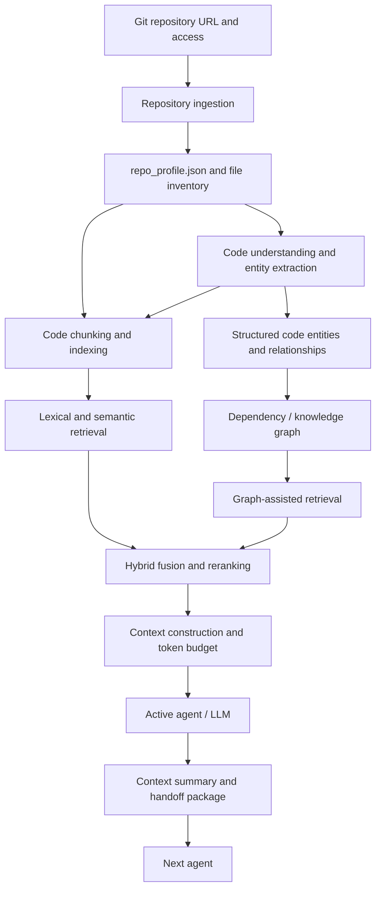

# RepoPilot: Repository Understanding and Context Management Research
## Technical Research Report — Draft

**Author:** Marwan Ehab Ibrahim  
**Workstream ID:** WS2 / cross-workstream research draft — *confirm with team*  
**Report ID:** RP-WS2-Repository-Understanding-and-Context-Management  
**Version:** v0.1 (draft)  
**Date:** 14 October 2026  
**Status:** Research draft. No final implementation choices have been approved.

---

# Summary

RepoPilot is intended to support AI agents working with AI-generated React/Vite, TypeScript, Supabase, and Stripe repositories. Agents need a reliable way to inspect a repository, understand its structure, retrieve relevant code, represent relationships between components, and preserve useful information across long-running tasks and agent handoffs. Reading the entire repository into an LLM context is potentially expensive and can introduce irrelevant information.

This report organizes the current brainstorming into a common technical-report structure. It covers five connected areas: repository ingestion, code understanding, Code Retrieval-Augmented Generation (Code RAG), dependency/knowledge graphs, and context-window strategy. The proposed research direction separates deterministic repository intake from deeper code analysis; investigates syntax-aware entity extraction; compares lexical, semantic, hybrid, and graph-assisted retrieval; and studies context management based on fixed instructions, long-term memory, and recent working memory.

The notes identify candidate tools and papers, but they do not establish a final architecture. No controlled experiments or project-specific measurements are documented yet. Therefore, this report does not claim that a particular parser, search index, graph store, reranker, or context-management policy has been selected or proven best. The immediate recommendation is to verify source papers and tool capabilities, agree on workstream boundaries and artifact schemas, and run reproducible spikes on the four sample repositories before making implementation decisions.

---

# Table of Contents

1. Introduction  
2. Background  
3. Procedure / Method  
4. Proposed Design  
5. Findings / Results  
6. Alternatives Considered  
7. Risks and Open Questions  
8. Conclusions  
9. Recommendations  
10. References  
Appendix A. Research Questions and Planned Spikes  
Appendix B. Draft Artifact Schemas

---

# 1. Introduction

## 1.1 Objective

This report organizes the current research notes for the repository-understanding and context-management components of RepoPilot. It identifies the problem each component addresses, the inputs and outputs that may connect the components, the candidate methods and tools to investigate, and the outstanding decisions that require team agreement.

The central research question is: **How should RepoPilot inspect a software repository, represent its code and relationships, retrieve task-relevant evidence, and manage that evidence within a multi-agent system without sending unnecessary information to an LLM?**

## 1.2 Scope

The report covers:

- Repository ingestion and profiling.
- Static code understanding and cross-file relationship extraction.
- Code chunking, lexical and semantic retrieval, hybrid retrieval, reranking, and context construction.
- Dependency/knowledge graph construction, storage, querying, and graph-assisted retrieval.
- Context-window management and its relationship to agent handoff.

The target repository stack described in the notes is React, Vite, TypeScript/TSX, Supabase, and Stripe. The report records candidate approaches rather than approving a production architecture. Agent orchestration, test execution, automated repair, and the full Agent Handoff Protocol are outside this report except where integration with these research areas is necessary.

## 1.3 Context within RepoPilot

The notes describe a pipeline in which repository intake produces a profile and file inventory; code-understanding and graph components extract structural information; Code RAG finds task-relevant repository evidence; and context management decides what information should remain in the active LLM context or be transferred to another agent.

The boundaries between repository ingestion, code understanding, and graph construction remain open. The team should agree on ownership before implementation.

# 2. Background

## 2.1 Repository ingestion

Repository ingestion is proposed as a deterministic intake stage that does not call an LLM or execute repository code. It would acquire a repository at a pinned commit, inventory files, detect the stack from configuration files, collect inexpensive metadata, scan for secrets, inspect selected Git history, and emit a repository profile.

The notes propose avoiding dependency installation during intake because repository-controlled configuration and lifecycle scripts can introduce risk. They also propose scanning the working tree and Git history for secrets before repository content is sent to an LLM. These are design proposals in the brainstorming notes and require validation against the final sandbox and security policy.

## 2.2 Code understanding

Code understanding extracts structured facts from source code: functions, classes, React components, custom hooks, types, imports, exports, routes, and database operations. Cross-file analysis then identifies relationships such as imports, calls, component usage, and database access.

The notes identify Tree-sitter, the TypeScript Compiler API, SCIP/scip-typescript, Pygments, and libpg_query as candidates for different tasks. They are not interchangeable: each addresses a different level of syntax, language semantics, symbol indexing, lexical processing, or SQL parsing. Their suitability for the chosen repository stack remains to be evaluated.

## 2.3 Code Retrieval-Augmented Generation

Code RAG retrieves repository evidence relevant to a task instead of placing the entire codebase into the LLM context. The research topics are:

- Syntax-aware, function-level, or class-level chunking.
- Code embeddings and vector search.
- Keyword and identifier search.
- Hybrid retrieval and rank fusion.
- Reranking retrieved candidates.
- Context construction under a token budget.
- Evaluation of retrieval relevance, completeness, ranking, latency, and downstream task performance.

The notes list FAISS, vector databases, BM25, Elasticsearch/OpenSearch, Reciprocal Rank Fusion (RRF), the BestFit method discussed in a named CodeRAG paper, and cross-encoder rerankers as items to investigate. These are candidates, not confirmed selections. FAISS is described in the notes as a vector-search library rather than an embedding model.

## 2.4 Dependency and knowledge graphs

A graph represents entities as nodes and relationships as edges. For a software repository, possible nodes include files, functions, components, hooks, API endpoints, database tables, libraries, and configuration elements. Possible edges include `IMPORTS`, `CALLS`, `RENDERS`, `USES_HOOK`, `QUERIES_TABLE`, `DEFINES`, and `DEPENDS_ON`.

A dependency graph focuses on dependencies; a knowledge graph may represent a broader set of semantic relationships. The exact distinction varies by paper, so the report does not impose a universal definition. Candidate graph representations include in-memory structures, NetworkX, and Neo4j. A dedicated graph database is not assumed to be necessary.

## 2.5 Context-window strategy

A context window contains the information an LLM can process at one time, including instructions, conversation history, code snippets, tool outputs, and agent messages. Context-window strategy decides what to retain, summarize, remove, retrieve again, or transfer to another agent.

The notes discuss *Context as a Tool: Context Management for Long-Horizon SWE-Agents* (CAT), identified in the notes as published in Findings of ACL 2026. CAT is described as treating context management as an action an agent can invoke. Its three context segments are:

- **Fixed segment:** stable instructions, objective, and constraints.
- **Long-term memory:** compressed findings, decisions, outcomes, and persistent facts.
- **Working memory:** recent interactions, tool results, and current subtask details.

The notes report a 57.6% solved rate on SWE-Bench-Verified for SWE-Compressor in the paper's evaluated setup. This is a paper-reported result as recorded in the notes, not a prediction for RepoPilot. The original paper and its experimental conditions must be checked before citing the figure in a submitted report.

# 3. Procedure / Method

## 3.1 Current research method

The source material is a brainstorming and research-notes document. It identifies questions, candidate tools, research papers, proposed pipeline steps, and planned validation spikes. It does not document a completed systematic literature review or completed project experiments.

The next research iteration should:

1. Read the original papers and official documentation for each shortlisted approach.
2. Record the actual methods and tools used by each paper, separating verified facts from ideas proposed for RepoPilot.
3. Apply candidate methods to the same four sample repositories.
4. Record runtime, file counts, lines of code, token counts, retrieval results, graph coverage, and context size where relevant.
5. Compare results using the same queries and evaluation criteria.
6. Review the results with the team before approving implementation choices.

## 3.2 Planned validation spikes

The notes explicitly propose these ingestion spikes:

- Clone four sample applications and record elapsed time, file count, lines of code, and token count.
- Compare detected stack information against known ground truth.
- Test in a sandbox whether a hostile `.npmrc` can affect the intended `--ignore-scripts` behavior.
- Label commits as AI-authored or human-authored and compare those labels with a manual review.

Additional spikes should evaluate code entity extraction and cross-file links, compare retrieval methods on a shared query set, test graph queries against known relationships, and measure the quality of context summaries and handoffs. These additional spikes are proposed follow-up work, not completed experiments.

# 4. Proposed Design

The architecture in this section is a **research proposal**, not an approved implementation. Figure 4.1 summarizes the intended flow at a conceptual level.



**Figure 4.1.** Conceptual relationship between repository intake, code understanding, retrieval, graph information, context management, and agent handoff. The diagram shows proposed responsibilities; it does not confirm the final interfaces.

## 4.1 Inputs

| Input | Format / content | Source or owner | Status |
|---|---|---|---|
| Repository URL | GitHub URL; optional access credential | User interface / ingestion | Proposed |
| Sandbox and network policy | Isolated working directory and permitted network access | WS2 / team security design | Open |
| Secret-scan output | Tool findings and redaction information | WS3 / security component | Tool and schema to confirm |
| Artifact conventions | `schema_version`, `run_id`, `commit_sha`, `created_by` | WS4 | Schema coordination required |
| Source files and configuration | TypeScript/TSX, React, package files, migrations, configuration | Repository | Read statically at intake |
| Git history | Commits, authors, messages, trailers, patches | Repository | Full-history requirement to validate |
| User task or agent query | Natural-language task, identifiers, or code question | Agent orchestration | Interface to confirm |
| Model and token limits | Model context capacity and tokenizer information | Runtime configuration | Model-specific values not yet set |
| Sample repositories and test queries | Four sample apps and a repeatable query set | Team | Ground truth and query set to prepare |

## 4.2 Process

### 4.2.1 Repository ingestion

The current proposal is to:

1. Clone the repository into the designated sandbox, check out a detached commit, and record the commit SHA. Private-repository authentication should use a short-lived credential where supported.
2. Walk the repository while respecting `.gitignore`; skip generated output, dependencies, binaries, and other excluded files. Record path, language, lines of code, and token count per file.
3. Detect the stack by statically reading files such as `package.json`, lockfiles, `vite.config.*`, `tsconfig.json`, `supabase/config.toml`, and `.env.example`. Do not install dependencies as part of profiling.
4. Extract inexpensive metadata, including environment-variable names, browser-exposed `VITE_*` variables, Stripe SDK indicators, TODO/FIXME markers, and database/RLS information from migrations where reliable parsing is available.
5. Inspect Git history for commit count, development span, frequently changed files, and possible AI-authorship markers. Treat authorship labels as uncertain evidence, not definitive proof of how code was produced.
6. Scan the working tree and Git history for secrets before sending repository content to an LLM. Redact or exclude sensitive findings according to the agreed policy.
7. Emit `repo_profile.json` and pass the file inventory to the code-understanding component.

### 4.2.2 Code understanding and entity extraction

The code-understanding component should investigate static extraction of functions, methods, React components, hooks, classes, variables, types, interfaces, imports, exports, routes, and database operations. For each entity, the team should decide which metadata is required, such as name, entity type, file path, source range, signature, parameters, and associated imports.

The component should also investigate cross-file relationships. Syntax analysis may identify some relationships directly, while resolving symbols or understanding dynamic and indirect references may require language-specific semantic analysis or custom logic. The research must define which relationships this component emits and which belong to the graph-building component.

Candidate approaches to compare include Tree-sitter, the TypeScript Compiler API, SCIP/scip-typescript, Pygments as a lexical supplement, and libpg_query for SQL parsing. No tool is selected at this stage.

### 4.2.3 Code RAG indexing and retrieval

The Code RAG research pipeline should compare the following stages:

1. **Chunking:** compare syntax-aware chunks with function- or class-level chunks and a fixed-size baseline. Preserve source paths, line ranges, and symbol names as metadata.
2. **Semantic retrieval:** investigate code embedding models and vector indexes such as FAISS or a suitable vector database. Keep the distinction clear: the embedding model generates vectors; the index searches them.
3. **Lexical retrieval:** compare exact identifier search with BM25-based search. Elasticsearch and OpenSearch are candidate platforms, not required dependencies.
4. **Hybrid retrieval:** combine lexical and semantic candidate lists and evaluate a fusion method such as RRF. Verify which fusion methods are actually used by each research paper before attributing them to that paper.
5. **Reranking:** investigate the paper-specific BestFit approach described in *CodeRAG: Finding Relevant and Necessary Knowledge for Retrieval-Augmented Repository-Level Code Completion* and compare it with cross-encoder reranking. These should be evaluated as distinct approaches.
6. **Graph-assisted retrieval:** test whether graph traversal adds useful related entities that lexical or semantic retrieval misses.
7. **Context construction:** deduplicate candidates, select relevant dependencies, order evidence, and enforce a token budget before sending the context to an LLM.

### 4.2.4 Dependency / knowledge graph

The graph research should define node and edge types before selecting a storage tool. Initial candidate nodes include files, functions, components, hooks, routes, database tables, libraries, and configuration elements. Candidate relationships include `IMPORTS`, `CALLS`, `RENDERS`, `USES_HOOK`, `QUERIES_TABLE`, `DEFINES`, and `DEPENDS_ON`.

Investigate static analysis, Tree-sitter, the TypeScript Compiler API, and custom extraction logic for creating nodes and edges. Compare in-memory structures, NetworkX, and Neo4j based on graph size, query needs, persistence, operational complexity, and maintainability. The graph should support focused queries, such as finding callers of a function, components that use a hook, or database tables accessed by a component.

Graph construction must remain distinct from graph-assisted retrieval: construction creates and maintains the relationship representation; retrieval uses that representation to select useful context.

### 4.2.5 Context-window management

The current research direction is to test a context assembled from three logical segments:

- **Fixed context:** stable system instructions, task objective, and constraints.
- **Long-term memory:** compressed findings, completed subtasks, decisions and reasons, failed strategies, relevant tool feedback, and persistent facts.
- **Working memory:** recent interactions, current code and error details, tool outputs, and the active subtask.

At appropriate milestones, the agent may summarize older interactions and reconstruct its active context from these segments. The summary should retain evidence, exact file paths and symbol names when needed, unresolved issues, and next actions. It should not merely narrate that work occurred.

The system should investigate when context management is invoked, what is summarized or retained verbatim, how stale claims are corrected, and when an agent should retrieve original evidence again. The CAT paper is a research reference, not a mandate to reproduce its training pipeline.

### 4.2.6 Agent handoff integration

Before an agent transfers responsibility, it should prepare a compact handoff containing the objective, completed work, findings and evidence, decisions, relevant paths and symbols, unresolved questions, constraints, and next actions. The receiving agent should be able to retrieve original repository evidence when the handoff summary is insufficient.

This is a proposed integration principle. The exact handoff schema and ownership belong with the Agent Handoff Protocol work and must be coordinated with the team.

### 4.2.7 Evaluation procedure

Use the same sample repositories and query set to compare alternatives. At minimum, investigate:

- Ingestion time, file count, lines of code, and token count.
- Accuracy of detected stack and extracted entities against manually checked ground truth.
- Coverage and correctness of cross-file relationships.
- Retrieval relevance, completeness, ranking quality, and context efficiency.
- Retrieval/reranking latency and computational requirements.
- Graph-query correctness and the usefulness of graph-assisted retrieval.
- Context size, token cost, latency, retained-detail quality, and downstream task success.

The metrics and ground-truth creation process must be finalized before experiments begin. The notes contain no project-specific measurement results yet.

## 4.3 Outputs

| Artifact / output | Proposed contents | Consumer | Status |
|---|---|---|---|
| `repo_profile.json` | Schema/version metadata, commit and source information, stack/runtime, database metadata, fingerprints, commit statistics, size metrics, TODOs, redaction count, warnings | WS2, WS3, WS4 and downstream components | Draft schema |
| `file_inventory` | Per-file path, language, lines of code, token count | Code understanding and other research components | Proposed |
| Commit-history extract | Commit metadata and tentative AI/human labels | WS4 and code understanding | Label reliability open |
| Code entity records | Entity type, name, path, source range, signature and selected metadata | Graph construction and retrieval | Schema not defined |
| Relationship records / graph | Typed nodes and edges with source references | Graph queries and graph-assisted retrieval | Types and storage open |
| Code RAG index | Chunks, source metadata, lexical index and/or vectors | Retrieval component | Index design open |
| Retrieved context package | Ranked snippets, source locations, relevance data and token estimate | Agent / LLM context builder | Schema not defined |
| Context memory summary | Objective, findings, decisions, evidence, failed strategies, constraints and remaining tasks | Current and subsequent agents | Schema not defined |
| Handoff package | Task state, evidence, decisions, relevant code locations, unresolved questions and next actions | Receiving agent | Coordinate with Agent Handoff Protocol |

### Draft `repo_profile.json` fields

The notes suggest fields such as `schema_version`, `run_id`, `commit_sha`, `created_by`, `source`, `stack`, `runtime`, `database`, `fingerprints`, `commits`, `size`, `todos`, `redactions_count`, and `warnings`. The detailed schema, optional fields, and validation rules still need to be agreed with WS4.

## 4.4 Context-window and cost considerations

The brainstorming notes do not specify a final LLM, embedding model, tokenizer, context limit, per-app cost estimate, or token budget. These values must not be invented.

The proposed controls are:

- Count tokens per file during ingestion to establish repository-size estimates.
- Use retrieval to select relevant snippets rather than providing the entire repository.
- Remove duplicates and irrelevant candidates before prompt construction.
- Reserve context capacity for system instructions, user requirements, tool outputs, and the model response.
- Summarize older interaction history while retaining recent working details and important evidence.
- Retrieve original source information again when a summary is uncertain or lacks the detail needed for a decision.
- Measure token usage, latency, retrieval quality, and downstream task success together.

A cost model should be added after the team chooses candidate models and providers. It should separate ingestion compute, embedding/indexing, retrieval and reranking, LLM input/output tokens, and any graph-storage or query overhead.

## 4.5 Integration points

| Component / workstream | Depends on | Provides to | Coordination required |
|---|---|---|---|
| Repository ingestion | Sandbox/network policy, secret scanner, artifact schema | Repository profile and file inventory | WS2, WS3, WS4 |
| Code understanding | File inventory and source files | Entity records and extracted relationships | Agree boundary with ingestion and graph construction |
| Dependency/knowledge graph | Entity records and relationship extraction | Graph queries and structural context | Define node/edge schema and graph ownership |
| Code RAG | File inventory, code chunks, optional graph results | Ranked evidence and context candidates | Agree chunk metadata, retrieval interfaces, and evaluation set |
| Context-window strategy | Retrieved evidence, agent/tool history, task objective | Active context and compressed memory | Coordinate with agent runtime and handoff design |
| Agent Handoff Protocol | Current task state, context summary, evidence references | Handoff package for the next agent | Agree a stable handoff schema and provenance rules |

# 5. Findings / Results

## 5.1 Findings supported by the current notes

The current document supports the following research conclusions, but not final tool-selection claims:

1. Repository ingestion, code understanding, graph construction, retrieval, and context management are related stages with different responsibilities. Their interfaces need to be explicit.
2. The ingestion proposal favors deterministic static inspection and secret scanning before sending repository content to an LLM. The security controls and sandbox network policy still need validation.
3. Code RAG contains several separable decisions: chunking, semantic retrieval, lexical retrieval, fusion, reranking, context construction, and evaluation. No single candidate tool covers all of these concerns.
4. Code understanding and graph construction overlap in extracting relationships. The team needs to define which component emits relationship records and which component stores and queries them.
5. Context management, Code RAG, and agent handoff solve different problems: Code RAG finds repository information; context management chooses what remains in the active model context; handoff transfers relevant task information and responsibility.
6. The notes identify CAT, SGAgent, RepoMem, and CodeRAG-related papers as relevant research leads. Their detailed claims and implementation methods require checking against original papers and official resources.
7. No controlled project experiments, tool benchmarks, or validated architecture decisions are documented in the brainstorming source.

## 5.2 Evidence still to verify

The brainstorming notes contain several paper-reported statistics and claims, including repository-size figures, vulnerability findings, RepoMem results, and a SWE-Compressor result. These must be checked against the original publications and their experimental settings before inclusion as evidence in a submitted technical report. In particular, results from one dataset or benchmark should not be assumed to predict RepoPilot performance.

## 5.3 Results required from planned experiments

No results are available yet for:

- Ingestion runtime and repository inventory accuracy.
- Secret-scanning coverage and redaction behavior.
- AI/human commit-label reliability.
- Entity extraction precision and recall.
- Cross-file relationship coverage.
- Lexical, semantic, and hybrid retrieval comparisons.
- Reranking gains versus added latency.
- Graph-assisted retrieval gains.
- Context-summary fidelity and handoff success.
- End-to-end downstream task performance.

These are pending measurements, not negative results.

# 6. Alternatives Considered

The table records alternatives named in the brainstorming notes. It does not imply that a formal benchmark has already been completed.

| Decision area | Alternatives in the notes | Current position / reason |
|---|---|---|
| Repository acquisition | Full Git clone; shallow clone; ZIP upload | Full clone is proposed because history supports intent evidence and hotspots. Shallow clone loses history. ZIP handling remains an open v1 decision; the notes propose stripping `.git` before accepting a ZIP. |
| Stack detection | Deterministic configuration parsing; LLM-based detection | Deterministic parsing is preferred in the proposal because it is cheaper and reproducible. Validate detection against sample apps. |
| Intake execution | Static inspection; dependency installation or code execution | Static inspection is proposed to reduce exposure to untrusted repository scripts. Validate the final sandbox policy. |
| Code parsing | Tree-sitter; TypeScript Compiler API; other extraction methods | Compare based on language support, entity extraction, symbol resolution, and maintenance cost. No selection yet. |
| Symbol relationships | Syntax-derived links; semantic resolution with TypeScript/SCIP; custom logic | Determine which links can be extracted reliably and what requires deeper analysis. |
| Code chunking | Fixed-size; syntax-aware; function-level; class-level | Compare retrieval quality and context completeness on the target stack. |
| Semantic search | Embedding model plus FAISS; embedding model plus vector database | Select only after comparing retrieval quality, storage, latency, and operating complexity. |
| Lexical search | Exact identifier search; BM25 with Elasticsearch/OpenSearch | They address overlapping but different use cases; compare on the same query set. |
| Retrieval fusion | Single retrieval path; hybrid lexical and semantic retrieval; multi-path retrieval | Hybrid and multi-path approaches are research candidates; measure whether they improve relevance and completeness. |
| Reranking | Initial retrieval order; paper-specific BestFit; cross-encoder reranker | Compare quality gains against latency and cost. BestFit and cross-encoder reranking are not synonymous. |
| Graph representation | In-memory structures; NetworkX; Neo4j | A dedicated graph database is not assumed necessary. Choose based on query, persistence, scale, and operational needs. |
| Context management | Unbounded full history; automatic compression alone; intentional context-management action | Investigate fixed, long-term-memory, and working-memory segments; validate invocation policy and summary quality. |
| Repository memory / graph research | SGAgent; RepoMem; CAT and CodeRAG-related approaches for adjacent concerns | Use as research references. Verify exact architectures, methods, and reported results in primary sources. |

# 7. Risks and Open Questions

| ID | Risk / question | Priority in notes | Owner / next action |
|---|---|---|---|
| Q1 | Boundary between ingestion and code understanding | Medium | Maro with team: agree which operations require AST or symbol resolution |
| Q2 | ZIP uploads in v1 or Git URL only | Low | Team decision |
| Q3 | Sandbox is deny-by-default but cloning needs network access | High | WS2 (Farag): decide allowlisting or clone-and-copy workflow |
| Q4 | Reliability of AI/human commit labels and coverage of authoring-tool fingerprints | Medium | Validate labels manually on four sample apps; avoid treating labels as proof |
| Q5 | Several figures in the notes could not be confirmed from the reviewed sources | Medium | Verify each figure against the original paper before citation |
| Q6 | Whether command-line `--ignore-scripts` behavior overrides a repository `.npmrc` | Medium | Test in an isolated sandbox and verify official npm behavior |
| Q7 | Whether linked GitHub issues are necessary for repository-history analysis | Low | Evaluate usefulness and likely availability |
| Q8 | Runtime cost of scanning full Git history for secrets | Low | Measure during ingestion spikes |
| Q9 | Prompt injection through repository text sent to LLMs | Medium | WS4 with Maro: define trust boundaries and handling rules |
| Q10 | Tree-sitter, TypeScript Compiler API, and SCIP responsibilities may overlap | Open | Compare capabilities and define extraction ownership |
| Q11 | The graph-building boundary with code understanding is unresolved | Open | Agree entity/edge schemas and component ownership |
| Q12 | Best retrieval approach for TypeScript/TSX/Supabase repositories is unknown | Open | Benchmark candidate methods on a shared query set |
| Q13 | Graph storage and incremental graph updates are not selected | Open | Compare query needs, scale, persistence, and maintenance |
| Q14 | Context-management invocation, memory schema, and stale-information handling are undefined | Open | Review CAT and test summary/handoff policies |
| Q15 | Model, tokenizer, token budget, and cost estimates are not specified | Open | Select candidate runtime and measure token/cost profiles |
| Q16 | Primary-source details for several papers and reported results remain unverified | Medium | Check original papers and official implementations before final citation |

# 8. Conclusions

The brainstorming supports a modular research direction for RepoPilot: deterministic repository intake should create a stable profile and inventory; code understanding should extract structured entities and relationships; Code RAG should retrieve task-relevant evidence; graph representation should make repository relationships queryable; and context management should control what information remains active or moves between agents.

The components must remain distinct while sharing explicit schemas and provenance. In particular, code understanding and graph construction need a clear boundary, and graph-assisted retrieval should be evaluated as an addition to rather than a synonym for Code RAG. Context management should preserve the objective and important evidence while avoiding the unnecessary retention of every prior interaction.

The report does not establish that any candidate tool or method is best. The next reliable step is to verify the cited research, agree on interfaces, and run comparable experiments on the sample repositories.

# 9. Recommendations

**R1 — Agree on workstream boundaries.** The team should define which component owns file inventory, entity extraction, relationship extraction, graph construction, and retrieval.

**R2 — Finalize artifact schemas before implementation.** WS4 and the relevant workstream owners should define `repo_profile.json`, entity/relationship records, retrieved-context metadata, and handoff fields.

**R3 — Validate ingestion security assumptions.** WS2 and the security owner should test the sandbox network policy, secret scanning, archive handling, and repository-controlled configuration behavior in an isolated environment.

**R4 — Run the four planned ingestion spikes.** Record time, file count, lines of code, token count, stack-detection accuracy, and commit-label agreement with manual review.

**R5 — Build a shared retrieval evaluation set.** Include natural-language behavior queries and exact identifier queries; record expected relevant files and symbols so lexical, semantic, hybrid, and reranking approaches can be compared fairly.

**R6 — Compare graph extraction and storage options.** Evaluate node/edge coverage, query correctness, update behavior, and operational complexity before choosing NetworkX, Neo4j, or in-memory structures.

**R7 — Test context-management policies with explicit measures.** Measure context tokens, summary retention of key facts and paths, stale-information errors, handoff completeness, latency, and downstream task success.

**R8 — Verify primary sources.** Check the original papers and official tool documentation for all methods, statistics, and implementation claims. Mark unsupported claims `[TO VERIFY]` until resolved.

**R9 — Keep draft status visible.** Do not present candidate tools, proposed schemas, or untested architectural ideas as approved decisions.

# 10. References

The following references are research leads transcribed from the brainstorming notes. Details marked **[TO VERIFY]** must be checked against the original publication or official resource before submission. Citation numbering should be finalized in order of first citation after verification.

[1] S. Liu, B. Jiang, J. Yang, Y. Li, J. Guo, X. Liu, and B. Dai, “Context as a Tool: Context Management for Long-Horizon SWE-Agents,” *Findings of ACL 2026*. [Online]. Available: https://aclanthology.org/2026.findings-acl.1032/. **[Verify full metadata and reported results.]**

[2] “CodeRAG: Finding Relevant and Necessary Knowledge for Retrieval-Augmented Repository-Level Code Completion,” EMNLP 2025. **[TO VERIFY: authors, proceedings details, pages, and official paper URL.]**

[3] “CodeRAG: Supportive Code Retrieval on Bigraph for Real-World Code Generation.” **[TO VERIFY: authors, venue, year, and URL.]**

[4] “Retrieval-Augmented Code Generation: A Survey with Focus on Repository-Level Approaches.” **[TO VERIFY: authors, venue, year, and URL.]**

[5] SGAgent. **[TO VERIFY: full paper title, authors, publication details, and official resource. The brainstorming notes cite arXiv:2602.23647.]**

[6] RepoMem. **[TO VERIFY: full paper title, authors, publication details, and official resource. The brainstorming notes cite arXiv:2510.01003.]**

[7] Tree-sitter documentation. **[Add verified official URL and access date.]**

[8] TypeScript Compiler API documentation. **[Add verified official URL and access date.]**

[9] SCIP / scip-typescript documentation. **[Add verified official URL and access date.]**

[10] FAISS documentation. **[Add verified official URL and access date.]**

[11] Elasticsearch or OpenSearch documentation for lexical search and BM25. **[Specify the source actually used and access date.]**

[12] Neo4j documentation and NetworkX documentation. **[Add the exact official pages used and access dates.]**

[13] libpg_query documentation or repository. **[Add verified official URL and access date.]**

[14] GitHub documentation on GitHub App installation tokens. **[Add exact official page and access date.]**

[15] npm documentation on lifecycle scripts and `ignore-scripts` configuration. **[Verify the behavior relevant to the proposed security test.]**

---

# Appendix A. Research Questions and Planned Spikes

## A.1 Repository ingestion

- Is the boundary between ingestion and code understanding defined by whether AST or symbol resolution is needed?
- Should v1 accept ZIP uploads, Git URLs, or both?
- How should the sandbox allow repository cloning while maintaining a deny-by-default network policy?
- How reliable are AI-authorship labels and repository fingerprints?
- Are linked issues useful enough to justify GitHub API access?
- What is the runtime cost of scanning the complete Git history for secrets?
- How should repository text be treated to reduce prompt-injection risk?

Planned spikes: profile four sample apps; verify stack detection; test `.npmrc` behavior in a sandbox; compare commit labels against manual review.

## A.2 Code understanding

- What information does Tree-sitter provide for TypeScript and TSX?
- Which entities and metadata should be extracted?
- Which relationships can be identified syntactically and which require semantic analysis?
- How should dynamic imports and indirect references be handled?
- What belongs in the code-understanding component versus the graph-building component?
- Are LLM-generated summaries necessary after deterministic structural extraction?

## A.3 Code RAG

- Which chunking strategy best preserves useful source context?
- Which embedding models support TypeScript/TSX code retrieval well?
- When is a dedicated vector database necessary?
- How do BM25 and exact identifier search compare?
- Does hybrid retrieval improve relevance and completeness?
- Does reranking improve the final context enough to justify latency and cost?
- How should context construction preserve dependencies while respecting a token budget?
- Which metrics fairly measure retrieval quality and downstream usefulness?

## A.4 Dependency / knowledge graph

- Which nodes and edge types are required?
- Which relationships require semantic resolution or project-specific logic?
- Is a graph database necessary for the expected repository size?
- How should direct and indirect dependencies be queried?
- Can graph traversal retrieve code missed by lexical or semantic retrieval?
- How should the graph be updated after files or symbols are changed, renamed, or deleted?

## A.5 Context-window strategy

- When should context management be invoked?
- What belongs in long-term memory and what must remain verbatim?
- How can summaries preserve paths, symbols, evidence, constraints, and unresolved questions?
- How should stale or contradicted information be corrected?
- Should summaries be shared across agents or customized for each agent?
- When should an agent consult memory versus retrieve original evidence?
- How should context management integrate with the Agent Handoff Protocol?
- How should context size, latency, cost, and task success be evaluated together?

---

# Appendix B. Draft Artifact Schemas

These are field sketches based on the brainstorming notes, not finalized JSON Schemas.

## B.1 `repo_profile.json`

```json
{
  "schema_version": "to_define",
  "run_id": "to_define",
  "commit_sha": "pinned_commit",
  "created_by": "to_define",
  "source": {
    "url": "repository_url",
    "branch": "branch_name"
  },
  "stack": {
    "frameworks": [],
    "versions": {},
    "package_manager": "to_detect"
  },
  "runtime": {
    "node_version": "to_detect",
    "scripts": [],
    "env_vars": []
  },
  "database": {
    "tables": [
      {
        "name": "table_name",
        "rls_enabled": "unknown",
        "policies": []
      }
    ]
  },
  "fingerprints": {},
  "commits": {
    "count": 0,
    "span_days": 0,
    "ai_ratio": "unknown",
    "hotspots": []
  },
  "size": {
    "files": 0,
    "loc": 0,
    "tokens": 0
  },
  "todos": [],
  "redactions_count": 0,
  "warnings": []
}
```

## B.2 Code entity record — fields to decide

- `entity_id`
- `entity_type`
- `name`
- `file_path`
- `start_line` / `end_line`
- `signature` or type information, where available
- `imports` / `exports`, where applicable
- provenance and extraction method
- unresolved-reference indicators

## B.3 Relationship record — fields to decide

- `source_entity_id`
- `relationship_type`
- `target_entity_id`
- source location or evidence
- resolution status and confidence, if the team defines a defensible measure
- extraction method and version

## B.4 Context memory / handoff — fields to decide

- task objective and constraints
- completed subtasks
- findings with evidence and source locations
- decisions and reasons
- attempted approaches and outcomes
- relevant paths, symbols, and tool feedback
- unresolved questions and known uncertainties
- next actions
- timestamp or repository commit so that stale information can be detected

---

**Drafting note:** This document reorganizes the supplied brainstorming notes into the report structure specified by the team’s technical-report writing guide. It deliberately retains unresolved items and does not convert proposed tools or unverified paper claims into confirmed decisions. Before submission, verify all references and figures, replace placeholders, confirm workstream/report metadata, and complete the planned experiments.
