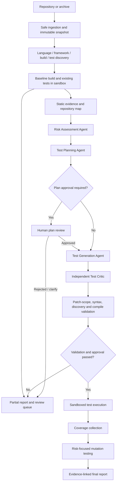

# A Stand-Alone Multi-Agent Pipeline for Test Quality Improvement in Vibe-Coded Repositories

| | |
|---|---|
| **Project** | RepoPilot: Evidence-Driven Multi-Agent QA and Repair |
| **Workstream** | WS1–WS4 – Cross-workstream prototype architecture for repository analysis, test planning, generation, and validation |
| **Author** | Not specified |
| **Report ID** | RP-CROSS-MultiAgentTestQuality |
| **Version** | v0.1 draft |
| **Date** | 14 October 2026 |
| **Reviewed by** | Pending technical review; pending non-expert review |

<div style="page-break-after: always;"></div>

## Summary

This report proposes a practical architecture for a stand-alone system that improves test quality in rapidly developed or AI-assisted (“vibe-coded”) applications. The system ingests an immutable repository snapshot, discovers its languages and build/test commands, establishes a baseline, scores application risks, plans behavior-oriented tests, generates a test-only patch, and validates that patch through independent review and deterministic checks. Approved tests execute in a disposable sandbox; coverage and mutation testing provide complementary evidence about exercised code and assertion strength. A central orchestrator manages state, artifacts, budgets, retries, and approvals, while narrowly scoped agents analyze risks, propose scenarios, generate tests, critique them, and summarize evidence. Repository code, dependencies, build scripts, and generated tests are treated as untrusted. The prototype should begin as a Python CLI, artifact-based state machine, SQLite metadata store, language adapters, and isolated Linux runner, supporting one ecosystem end-to-end before expanding. This is a design-stage report, not an implementation evaluation: no sample repository was executed and no empirical benchmark results are claimed. Numerical examples, risk weights, and sandbox limits are starting configuration values to validate experimentally. The recommendation is to prioritize execution isolation, source-linked risk-to-test traceability, independent test review, and mutation-based evaluation before adding distributed orchestration or many autonomous agents.

<div style="page-break-after: always;"></div>

## Table of Contents

- [Summary](#summary)
- [List of Abbreviations](#list-of-abbreviations)
- [1. Introduction](#1-introduction)
  - [1.1 Objective](#11-objective)
  - [1.2 Scope](#12-scope)
  - [1.3 Context within RepoPilot](#13-context-within-repopilot)
- [2. Background](#2-background)
  - [2.1 Evidence-Driven Testing and Mutation Testing](#21-evidence-driven-testing-and-mutation-testing)
  - [2.2 Repository Analysis and Secure Execution](#22-repository-analysis-and-secure-execution)
- [3. Procedure / Method](#3-procedure--method)
- [4. Proposed Design](#4-proposed-design)
  - [4.1 Inputs](#41-inputs)
  - [4.2 Process](#42-process)
  - [4.3 Outputs](#43-outputs)
  - [4.4 Context-Window and Cost Considerations](#44-context-window-and-cost-considerations)
  - [4.5 Integration Points](#45-integration-points)
- [5. Findings / Results](#5-findings--results)
- [6. Alternatives Considered](#6-alternatives-considered)
- [7. Risks and Open Questions](#7-risks-and-open-questions)
- [8. Conclusions](#8-conclusions)
- [9. Recommendations](#9-recommendations)
- [10. References](#10-references)
- [Appendix A: Artifact Contracts and Implementation Sketches](#appendix-a-artifact-contracts-and-implementation-sketches)
- [Appendix B: Reproducibility and Evaluation Log Format](#appendix-b-reproducibility-and-evaluation-log-format)

## List of Abbreviations

| Abbreviation | Meaning |
|---|---|
| API | Application Programming Interface |
| AST | Abstract Syntax Tree |
| CI | Continuous Integration |
| CPU | Central Processing Unit |
| JSON | JavaScript Object Notation |
| LLM | Large Language Model |
| PR | Pull Request |
| QA | Quality Assurance |
| SHA | Secure Hash Algorithm |
| VM | Virtual Machine |

---

## 1. Introduction

### 1.1 Objective

This report answers the following question: how should an engineer build a stand-alone multi-agent system that inspects an untrusted application repository, improves its test quality, and provides reproducible evidence of what was tested and how effective those tests were? The proposed design makes the orchestrator and deterministic tools authoritative for policy, execution, and measurements; AI agents provide bounded analysis and proposals.

### 1.2 Scope

The scope includes repository ingestion; language, framework, build, and test discovery; risk scoring; scenario planning; test generation and independent review; sandboxed execution; coverage and mutation testing; state management; reproducibility; reporting; security boundaries; and a prototype roadmap.

The first version is assumed to analyze one repository revision per job and to propose test changes rather than automatically repair production code. It is not intended to prove program correctness, replace an experienced security reviewer, infer undocumented business requirements with certainty, or execute arbitrary repository commands on the host. Browser-driven end-to-end tests, multi-tenant cloud scheduling, automatic production-code fixes, and organization-wide policy integration are later extensions. Unsupported languages must produce a transparent partial result instead of an invented command or a false success.

### 1.3 Context within RepoPilot

The design crosses the RepoPilot stages that turn a repository into validated QA evidence. Repository ingestion and stack discovery establish the inputs. Risk assessment and test planning create a traceable work queue. Test generation, critique, and validation create candidate test patches. The isolated runner, coverage collector, and mutation adapter create execution evidence. The reporting stage connects risks, tests, outputs, and approvals.

For workstream integration, the proposed hand-off is artifact-based rather than conversation-based. Upstream ingestion/discovery produces a repository manifest and stack profile; the risk and test-planning stages consume those artifacts; downstream validation and reporting consume the test patch, execution records, coverage, and mutation outcomes. The actual WS1–WS4 ownership map should be confirmed by the RepoPilot team; this report intentionally treats the implementation as cross-workstream because that mapping was not supplied.

## 2. Background

### 2.1 Evidence-Driven Testing and Mutation Testing

Code coverage measures whether instrumented code was executed. It is useful for locating unexercised lines and branches, but it does not establish that assertions detect incorrect behavior. The coverage.py documentation describes how branch coverage exposes alternate control-flow destinations missed by statement coverage [6]. Microsoft’s .NET testing guidance likewise describes line, branch, and method coverage as different measurements [8]. These measures should be reported separately and joined to risk-sensitive source locations rather than reduced to one global percentage.

Mutation testing evaluates tests by making small changes to a program and checking whether the test suite detects them. DeMillo, Lipton, and Sayward discussed program mutations and the coupling effect as a test-data-selection idea in 1978 [1]. Modern tools automate parts of this process; Stryker provides mutation testing for JavaScript and related ecosystems [7], and Stryker.NET provides a .NET implementation [9]. This report infers that mutation testing is particularly valuable for AI-generated tests because it can expose tests that execute code yet fail to assert its intended behavior. Mutation results remain imperfect evidence: equivalent mutants, invalid mutants, tool limitations, and timeouts must be classified separately.

For user-facing functionality, test design should prefer stable observable behavior over unnecessary dependence on implementation details. Testing Library’s guiding principles explicitly encourage tests that resemble how users interact with an application [2]. The same principle is applied here selectively: unit tests remain appropriate for pure logic, while integration or end-to-end tests are needed when the risk crosses system boundaries.

### 2.2 Repository Analysis and Secure Execution

Repository understanding should combine deterministic metadata and syntax analysis with bounded language-model reasoning. Tree-sitter provides a reusable parsing interface for source languages and can be used to build syntax-aware indexing where a plain filename or regular-expression approach is inadequate [3]. Parsing and manifests do not prove semantic correctness; they create more dependable evidence for agents to interpret.

Repository code cannot be treated as trusted merely because it is being tested. Install scripts, build targets, test code, and compiler plugins may execute code. Docker documents that CPU and memory limits are not universally imposed by default and provides mechanisms for limiting resource usage [4]. Firecracker’s design describes microVM isolation alongside defense-in-depth controls including seccomp, cgroups, namespaces, and process confinement [5]. The design inference is that the runner must be an explicit trust boundary: containerization and resource flags are necessary controls but are not, alone, a complete security guarantee for hostile multi-tenant workloads.

The architecture therefore separates a trusted control plane from untrusted repository execution, keeps secrets outside the sandbox, defaults test execution to disabled networking, and applies human approval to accepted patches. An LLM’s interpretation of source comments or repository documentation never grants additional permissions.

## 3. Procedure / Method

This document is a design synthesis based on the provided requirements and a review of primary tool documentation and the foundational mutation-testing reference listed in Section 10. Documentation was checked on 14 October 2026. The recommendations are intended as an implementation blueprint and must be validated against the team’s actual environment and threat model.

No runnable prototype, sample repository, commit SHA, toolchain lock, or benchmark run was supplied or executed for this report. Accordingly, Section 5 does not claim empirical success rates, measured coverage gains, throughput, or per-repository monetary cost. The e-commerce repository example in Section 4 and the numbers used in examples are illustrative only. They are not experimental results.

A repeatable implementation evaluation should pin the sample repository by Git commit SHA, record tool and image versions, run the original baseline, apply generated tests on a separate worktree, and compare baseline versus augmented coverage and mutation outcomes. A benchmark should include well-tested and poorly tested repositories, known defects, and intentionally injected mutations. The exact versions of language runtimes, test frameworks, coverage tools, mutation tools, model providers, and sandbox images must be recorded when the first prototype is executed.

## 4. Proposed Design

### 4.1 Inputs

Table 4.1 lists the inputs this component requires.

**Table 4.1** Inputs required by the RepoPilot test-quality pipeline

| Input | Format | Source (workstream / user) | Required or optional |
|---|---|---|---|
| `repository_source` | Local directory, archive, or approved Git URL | User / ingestion | Required |
| `source_revision` | Full Git commit SHA or canonical archive manifest hash | Ingestion | Required |
| `policy.yaml` | Versioned policy configuration | RepoPilot operator | Required |
| `language-matrix.yaml` | Adapter and capability registry | Platform configuration | Required |
| `runner_image` | Approved image reference pinned by digest | Platform / operations | Required for execution |
| `build_test_candidates` | Structured executable plus argument array and evidence | Discovery adapter | Required for build/test stages; may be unresolved |
| `existing_test_results` | JSON plus raw test output | Baseline runner | Required before claiming baseline comparison |
| `API specs / schemas` | OpenAPI, GraphQL schema, typed interface definitions, or equivalent | Repository / user | Optional |
| `business_rules` | Reviewed Markdown, acceptance criteria, examples, or contract fixtures | Repository / user / reviewer | Optional but important when expected behavior is ambiguous |
| `model configuration` | Provider/model ID, token caps, prompt-template version | Operator | Required only for AI-assisted stages |
| `approval profile` | Role and gate policy | RepoPilot operator / human reviewer | Required before accepting changes |
| `dependency lockfiles` | Ecosystem lockfiles and integrity data | Repository | Optional at ingestion; strongly preferred for repeatable builds |

The repository, scripts, manifests, and documentation are all treated as untrusted input. A command found in a manifest or suggested by an agent is only a candidate until an adapter validates it against policy. Input processing must limit total repository size, individual file size, file count, path depth, archive expansion size, and model-context size. Archive extraction must reject absolute paths, path traversal, and unsafe links.

### 4.2 Process

Figure 4.1 shows the proposed pipeline.



**Figure 4.1** Proposed repository-to-evidence pipeline with explicit approval and partial-result paths.

#### 4.2.1 Repository preparation, discovery, and baseline

**Repository identity and safe ingestion.** The ingestion service creates an immutable source snapshot and hashes a canonical file manifest. A run record stores the repository identifier, full revision, policy version, pipeline version, and timestamps. Git hooks and submodules are not executed or fetched implicitly. Git LFS objects and binary files are handled only under a defined policy. Secrets are detected and redacted before source is sent to a model or copied into logs. The system excludes generated dependencies and irrelevant files from analysis while retaining an explicit exclusion list so coverage denominators and source context remain auditable.

**Language and framework detection.** Discovery proceeds in evidence order: manifests and lockfiles, build and CI configuration, framework-specific configuration, then import syntax, decorators, entry points, and source structure. The output is a stack profile that includes confidence and supporting paths. Examples include `package.json` and lockfiles for Node.js projects, `pyproject.toml` for Python, `.sln` and `.csproj` for .NET, `pom.xml` or `build.gradle` for Java, `go.mod` for Go, `Cargo.toml` for Rust, and `composer.json` for PHP. Tree-sitter or ecosystem parsers can support source-aware discovery [3]. The prototype should not attempt full semantic analysis for every language.

**Build and test discovery.** The adapter inspects manifests, CI jobs, test configuration, and repository documentation before inferring a command. Each command is represented as an executable and argument array, working directory, allowed environment profile, timeout, network policy, and discovery evidence. Commands are never built by concatenating repository-controlled strings into a host shell command. An ambiguous or unsupported command becomes a `blocked` or `partial` result requiring review rather than an invented default.

**Baseline execution.** Build and existing tests run inside the sandbox before generated tests are applied. Capture exit codes, durations, test counts, skipped and failed cases, stdout/stderr within size limits, tool versions, resource usage, timeouts, and infrastructure status. Preserve the original source snapshot read-only. If the baseline build fails, allow static analysis and planning to continue when possible, but do not claim that generated tests passed against a working baseline.

**Static evidence and repository map.** Collect deterministic signals such as parse errors, complexity, imports/call relationships where available, route definitions, database writes, input-validation points, coverage, lint/security results, and test references. These are evidence for risk analysis, not proof of defects. A minimal prototype can start with manifest inspection, existing test results, basic file metrics, and a small set of known route/service patterns.

**Agent roles.** Keep logical responsibilities distinct, but do not require a separate deployed service for every role. The Repository Inspector and Stack Discovery roles produce manifests; the Baseline role calls the runner; the Risk Assessment Agent returns source-linked risks; the Test Planning Agent maps risks to behavior scenarios; the Test Generation Agent proposes a patch limited to approved test paths; the Test Critic independently reviews the proposed tests; the Validation and Execution roles invoke deterministic adapters; Coverage and Mutation roles interpret tool output without rewriting raw measurements; the Failure Triage Agent classifies errors; and the Reporting Agent summarizes evidence. AI-generated assertions, test plans, and explanations must remain separate from the tool’s actual pass/fail and measurement results.

#### 4.2.2 Risk-based planning, generation, validation, and measurement

**Risk assessment.** Build an evidence-backed risk register for authentication and authorization, data boundaries, payment or order calculations, database writes, file handling, external APIs, concurrency, configuration, error paths, serialization, and other critical behaviors present in the source. Useful signals include route handlers, validation branches, broad exception handling, recently changed functions when Git history is available, missing coverage, and security scanner results. Every finding contains a category, impact, likelihood, exposure, test gap, source references, confidence, and evidence status (`observed`, `inferred`, or `hypothesis`). High-impact security concerns can trigger a mandatory-review override independent of the numeric score.

A transparent starting score is:

\[
R = 20(0.35I + 0.25L + 0.15E + 0.25G)
\]

where impact \(I\), likelihood \(L\), exposure \(E\), and test gap \(G\) are each rated from 1 to 5. This yields a score from 20 to 100. Suggested initial bands are 80–100 critical, 60–79 high, 40–59 medium, and 20–39 low. These weights and bands are hypotheses for initial triage, not a validated risk model; they must be tuned against reviewer judgments and known defects. Uncertainty should lead to targeted analysis, not silently reduce the impact of a potential high-severity issue.

**Test planning.** The planner converts selected risks into atomic scenarios. Each plan item identifies the target symbol or route, associated risk IDs, test level, preconditions, inputs, expected observable behavior, oracle/specification source, dependencies/fixtures, priority, and approval status. Expected behavior should be grounded in reviewed requirements, existing contracts, source-defined invariants, or an explicit reviewer decision. If intent is ambiguous, the planner records an unresolved question rather than inventing a rule. The planner prefers the cheapest test level that actually exercises the risk: unit tests for pure logic, component tests for services and handlers, integration tests for persistence or service boundaries, and end-to-end tests for critical user journeys. Property-based tests are useful where broad invariants can be stated precisely.

**Test generation and independent critique.** The generator receives a bounded context bundle of relevant source excerpts, existing tests, approved scenarios, conventions, and patch permissions. It proposes a test-only patch by default. The critic receives the same authoritative source and plan, but not the generator’s conclusion as evidence; it evaluates distinct behavior, oracle validity, meaningful assertions, boundary coverage, over-mocking, order dependence, flaky timing, implementation coupling, and unsafe configuration. A failed review can cause a bounded revision cycle. Limit revisions to a configurable small number (for example, two) before escalation; repeated generation should not continue until the budget is exhausted.

**Deterministic validation.** Verify patch paths and size before parsing. Then run supported formatting/lint checks, syntax/type checks, test discovery, build/compile, original baseline tests, and the generated tests in the sandbox. Run selected tests repeatedly to detect nondeterminism. A test that fails may reveal a product defect, a false expectation, a bad fixture, a pre-existing baseline failure, or an infrastructure problem. Triage must classify the failure before any finding is labeled confirmed. A suspected product bug is reported separately; production-code modifications require a distinct patch and explicit human approval.

**Execution and measurements.** Execute only the approved job specification on the original source plus accepted test patch. Collect line/statement and branch coverage where supported, by production file and risk-sensitive component. Compare baseline and augmented test runs on the same source revision and instrumentation configuration. Mutation testing then uses an ecosystem adapter to insert bounded, realistic changes in high-priority code first. Classify each mutant as `killed`, `survived`, `no_coverage`, `invalid`, `equivalent` (only when supported by sufficient evidence), `timeout`, or `infrastructure_error`. Do not count a timeout or infrastructure failure as killed. A conventional score can be reported as killed divided by eligible mutants, multiplied by 100, but the denominator definition and all raw counts must accompany the score.

**Failure handling and final report.** Every stage can finish as `success`, `partial`, `blocked`, or `failed`, with a machine-readable reason. Preserve completed artifacts and generate a partial report when later stages cannot proceed. Retries are bounded and specific to transient infrastructure/dependency failures; deterministic assertion failures should not be blindly retried. Final acceptance requires a human to review the patch, test evidence, high-risk survivors, and remaining limitations. The system may create a proposed branch or PR after approval, but must not merge automatically in the initial version.

The following pseudocode defines the central control flow. The concrete implementation must add state transition validation, approval-token verification, timeouts, retries, leases, cancellation, artifact hashes, and guaranteed sandbox cleanup.

```python
def run_pipeline(repository, policy, store, agents, sandbox):
    snapshot = ingest_and_hash(repository, policy)
    store.save(snapshot)

    profile = agents.discovery.run(context(snapshot, policy, store))
    store.save(profile)

    baseline = sandbox.run_baseline(snapshot, profile, policy)
    store.save(baseline)

    risks = agents.risk.run(context(snapshot, profile, baseline, policy, store))
    store.save(risks)

    plan = agents.planner.run(context(snapshot, profile, baseline, risks, store))
    store.save(plan)
    if policy.require_plan_approval and not approval_granted(plan):
        return build_partial_report(snapshot, baseline, risks, plan,
                                    status="awaiting_plan_approval")

    patch = agents.generator.run(context(snapshot, risks, plan, store))
    store.save(patch)
    critique = agents.critic.run(context(snapshot, patch, risks, plan, store))
    store.save(critique)
    validate_patch_scope(patch, policy)

    validation = sandbox.validate(snapshot, patch, profile, policy)
    store.save(validation)
    if critique.status == "blocked" or not validation.passed:
        return build_partial_report(snapshot, risks, plan, patch, critique,
                                    validation, status="validation_failed")
    if not approval_granted(patch):
        return build_partial_report(snapshot, risks, plan, patch,
                                    status="awaiting_patch_approval")

    execution = sandbox.run_suite(snapshot, patch, profile, policy)
    store.save(execution)
    coverage = (sandbox.measure_coverage(snapshot, patch, profile, policy)
                if execution.trustworthy_for_coverage else None)
    if coverage:
        store.save(coverage)
    mutations = (sandbox.run_mutations(snapshot, patch, risks, coverage, policy)
                 if coverage and policy.mutation_enabled else None)
    if mutations:
        store.save(mutations)

    report = agents.reporter.run(context(
        snapshot, profile, baseline, risks, plan, patch, critique,
        validation, execution, coverage, mutations, store
    ))
    store.save(report)
    return report
```

The execution adapter separately validates a job specification and creates a disposable environment. It must not expose unrestricted host commands, credentials, arbitrary mounts, or runtime control to an agent. A minimal interface is:

```python
def execute_job(job, backend, policy):
    validate_job_spec(job, policy)  # allowlisted argv, image digest, paths, limits
    env = backend.create_disposable(
        image_digest=job.image_digest,
        cpu_limit=job.cpu_limit,
        memory_limit=job.memory_limit,
        process_limit=job.process_limit,
        network_policy=job.network_policy,
        filesystem_policy=job.filesystem_policy,
    )
    try:
        env.stage_readonly_source(job.source_snapshot)
        env.stage_approved_patch(job.approved_patch)
        result = env.execute_argv(
            executable=job.executable,
            args=job.args,
            cwd=job.working_directory,
            timeout=job.timeout_seconds,
            output_limit=job.output_limit,
        )
        return normalize_result(job, result)
    finally:
        backend.destroy(env)
```

**Secure execution boundary.** The trusted control plane includes the orchestrator, policy engine, approval service, metadata store, and sandbox controller. The untrusted zone includes source code, package install/build scripts, generated tests, compiler plugins, and mutation workloads. The runner should use a disposable Linux VM or hardened rootless container for a prototype. For public, hostile, multi-tenant repositories, evaluate stronger isolation such as gVisor or Firecracker microVMs [5]. Ordinary containers share the host kernel and are not equivalent to VMs.

Minimum restrictions include non-root execution, no privileged mode, no container-runtime socket, dropped capabilities, no inherited SSH/cloud/developer credentials, read-only source, a separate bounded scratch area, disabled test-time networking by default, restrictive seccomp and AppArmor/SELinux policy, CPU/memory/process/disk/output limits, externally enforced wall-clock timeout, and cleanup on every exit path. Docker documents why explicit resource limits are needed [4]. Dependency acquisition can use a separate allowlisted proxy/cache phase; tests should run offline whenever possible. Never fix dependency failures by broadly mounting host directories or disabling isolation.

Example prototype starting limits are 2 CPU cores, 2 GiB memory, 256 processes, five minutes for a normal unit-test job, 1 GiB writable scratch space, and 10 MiB captured output. These values must be tuned with real workloads. Mutation jobs need a separate aggregate budget. The host controller, not the child process, enforces timeouts and kills the full process tree. Sandboxing reduces risk but does not make hostile code risk-free.

**Detecting weak tests.** The quality layer flags tests with no meaningful assertions, assertions that are trivially true, swallowed exceptions, over-mocking, unexercised branches, repeated scenarios, global-state/order coupling, fixed sleeps, missing cleanup, and tests that pass without executing the relevant production logic. AST heuristics can detect some patterns; independent review and mutation testing are needed for semantic weaknesses. Surviving mutants are investigation targets, not automatic defects. Conversely, high coverage or mutation score cannot correct an incorrect expected behavior; critical oracle assumptions require a specification or human confirmation.

### 4.3 Outputs

**Table 4.2** Outputs produced by the RepoPilot test-quality pipeline

| Output artifact | Format | Consumer (workstream / agent) | Purpose |
|---|---|---|---|
| `repo_manifest.json` | JSON, schema versioned | Discovery, orchestrator | File inventory, hashes, exclusions, source roots |
| `stack_profile.json` | JSON | Adapters, orchestrator | Languages, frameworks, candidate commands, confidence |
| `baseline_results.json` | JSON plus linked raw logs | Risk Agent, reporting | Existing build/test outcomes and environment details |
| `static_findings.json` | JSON / supported scanner format | Risk Agent | Deterministic source-level signals |
| `risk_register.json` | JSON | Planner, critic, report | Ranked risks with factor explanations and evidence |
| `test_plan.json` | JSON | Generator, reviewer | Behavior-oriented scenarios linked to risks |
| `proposed_tests.patch` | Unified diff | Critic, validation, human reviewer | Test-only proposal, isolated from the original branch |
| `critic_report.json` | JSON | Generator, orchestrator, reviewer | Independent test-quality issues and revision guidance |
| `validation_results.json` | JSON | Orchestrator, report | Scope, syntax, discovery, compile, and baseline checks |
| `execution_results.json` | JSON plus bounded logs | Coverage, triage, report | Exit codes, per-test results, resource usage, failure classes |
| `coverage_report.json` | JSON / Cobertura / ecosystem output | Risk Agent, Mutation adapter, report | Line/branch coverage and high-risk component gaps |
| `mutation_report.json` | JSON plus mutator output | Planner, report, reviewer | Mutant outcomes, raw counts, denominator, surviving mutants |
| `test_quality_report.json` | JSON and HTML | User / reviewer / CI | Consolidated results, evidence, approvals, limitations, patch links |
| `audit_events.jsonl` | JSON Lines | Operator / auditor | Append-only stage events, decisions, hashes, approvals |

Schema sketch for `test_quality_report.json`:

```json
{
  "schema_version": "0.1",
  "run_id": "job-2026-001",
  "repository": {
    "repository_id": "example-app",
    "commit_sha": "FULL_GIT_COMMIT_SHA",
    "source_tree_sha256": "CANONICAL_MANIFEST_HASH"
  },
  "pipeline_version": "0.1.0",
  "policy_version": "1.0",
  "status": "partial",
  "stages": {
    "baseline": "success",
    "risk_analysis": "success",
    "test_generation": "success",
    "validation": "success",
    "execution": "success",
    "coverage": "success",
    "mutation": "unsupported"
  },
  "risk_register_ref": "artifact://risk_register.json",
  "test_plan_ref": "artifact://test_plan.json",
  "patch_ref": "artifact://proposed_tests.patch",
  "measurements": {
    "line_coverage_before": null,
    "line_coverage_after": null,
    "branch_coverage_before": null,
    "branch_coverage_after": null,
    "mutation_score": null,
    "mutation_denominator_policy": "documented per adapter"
  },
  "approval": {
    "plan": "approved",
    "patch": "pending"
  },
  "limitations": ["Mutation adapter unavailable for the detected stack"]
}
```

Null measurements mean that no reliable value is available; they must not be displayed as zero. The `status` field should distinguish `success`, `partial`, `blocked`, and `failed`. A no-finding result is different from a failed or unsupported measurement.

### 4.4 Context-Window and Cost Considerations

The first prototype should use a small number of bounded model calls rather than put the whole repository into every prompt. A practical starting budget is one call for stack interpretation when deterministic discovery is inconclusive, one risk-analysis call per bounded module batch, one planning call per selected risk batch, up to three generation batches, one independent critic call per patch, at most two targeted revise/review cycles, and one final reporting call. Failure triage is invoked only when an actual failure needs classification. These are operational caps to test, not empirically optimal values.

Start with context bundles in the approximate range of 8,000–12,000 input tokens per analysis task and 2,000–4,000 output tokens for structured artifacts; tune by model capability and source size. Include the repository manifest, selected source excerpts with line numbers and hashes, linked risk IDs, approved scenario, framework conventions, and the precise output schema. Retrieve imports, callers, tests, and configuration on demand. Exclude vendored code, generated bundles, binary content, duplicate excerpts, secrets, and irrelevant documentation by default.

Use Pydantic or JSON Schema to validate every model output. Store model/provider ID, prompt-template version, token usage, latency, retry count, and output hash. Model output is not assumed to be bit-for-bit reproducible even with the same inputs; reproducibility comes from retaining the actual output and all relevant inputs. Deterministic discovery and measurement stages should be cached by commit hash, relevant artifact hashes, policy version, adapter/tool version, image digest, and configuration. Do not cache across a changed source snapshot.

Do not claim a dollar estimate before selecting a model and measuring token consumption. Cost per app should be measured as the sum of model input/output charges, sandbox compute, dependency acquisition, storage, and human review time. Enforce a hard ceiling on tokens, agent calls, test count, mutation count, wall-clock time, and output bytes. A sample implementation could stop after 25 model calls or a configurable spend budget and return a partial report; both thresholds should be configurable rather than hidden in code.

### 4.5 Integration Points

The proposed cross-workstream contracts are:

- **Ingestion/discovery → analysis:** immutable source snapshot, repository manifest, stack profile, source exclusions, build/test command candidates, and file hashes.
- **Baseline → risk analysis:** baseline pass/fail state, test inventory, existing coverage, scanner outputs, and environment limitations.
- **Risk analysis → planning:** evidence-linked risk register with transparent factor scores, source locations, confidence, and review overrides.
- **Planning → generation:** approved test-plan entries, expected-behavior sources, target symbols, priority, and fixtures.
- **Generation → critic/validation:** patch diff, provenance, list of changed paths, linked plan entries, and generator metadata.
- **Validation → execution:** only an approved patch hash and a sandbox job specification validated by the policy engine.
- **Execution → measurement:** normalized test result, instrumentation status, tool version, and exact source/patch hashes.
- **Coverage → mutation:** production-file coverage map and risk-prioritized mutation scope.
- **All stages → reporting:** immutable artifact references, state and failure codes, measurements, approval history, and limitations.

Every shared artifact needs a schema version and stable IDs. Agents must not write directly to one mutable shared conversation or overwrite results produced by another stage. An immutable artifact store plus a relational metadata store provides traceability. SQLite and JSON files are appropriate for a local prototype; PostgreSQL/object storage become relevant when workers run concurrently or artifacts become large.

The orchestration state machine should include `INGESTED`, `DISCOVERED`, `BASELINE_COMPLETE`, `ANALYZED`, `PLAN_READY`, `PLAN_APPROVED`, `GENERATED`, `CRITIC_REVIEWED`, `VALIDATED`, `PATCH_APPROVED`, `EXECUTED`, `COVERAGE_COMPLETE`, `MUTATION_COMPLETE`, and `REPORT_READY`, plus `BLOCKED_POLICY`, `BASELINE_FAILED`, `VALIDATION_FAILED`, `EXECUTION_TIMEOUT`, `INFRASTRUCTURE_ERROR`, and `PARTIAL_RESULTS`. Transitions are enforced in code, not suggested by an agent.

The initial project can be implemented as one Python repository with a Typer CLI, Pydantic contracts, plain Python state machine, SQLite, JSON artifacts, and a disposable Linux runner. FastAPI is optional if an API is needed. LangGraph can be considered later if graph branching and human-in-the-loop checkpointing become difficult to maintain; a distributed queue, Redis, PostgreSQL, Temporal, Kubernetes, and OpenTelemetry are optional scaling and operations choices, not prerequisites.

Suggested project structure:

```text
test-quality-agent/
  pyproject.toml
  README.md
  configs/
    default-policy.yaml
    language-matrix.yaml
    resource-limits.yaml
  schemas/
    repository-manifest.json
    risk-register.json
    test-plan.json
    execution-result.json
    final-report.json
  src/test_quality/
    cli.py
    settings.py
    contracts/          # artifacts, risks, plans, results
    ingestion/          # snapshot, archive safety, hashes, redaction
    discovery/          # language, framework, commands
    analysis/           # static evidence, source map, risk scoring
    agents/             # risk, planner, generator, critic, triage, report
    orchestration/      # pipeline, state machine, approvals, budgets
    runners/            # sandbox interface, runtime adapters, cleanup
    adapters/           # python, node, dotnet, java, later ecosystems
    quality/            # validation, coverage, mutation, flakiness
    storage/             # metadata, artifact store, cache
    reporting/           # HTML and JSON reports
  runner-images/
    python/
    node/
    dotnet/
    java/
  tests/
    unit/
    integration/
    security/
    fixtures/
    evaluation/
  examples/
    simple-python-api/
    vulnerable-demo-app/
```

Build one complete language adapter before generalizing all of the classes. A reasonable first ecosystem is TypeScript/Node if the intended benchmark repositories are web applications; Python is equally reasonable if it simplifies the initial prototype. The architectural contracts remain language-independent.

## 5. Findings / Results

This section records what is supported by the design and documentation review. It does not present prototype metrics because no prototype was run.

**Finding 1 — Coverage must be interpreted at more than one level.** Branch coverage can expose missing decision outcomes that line/statement coverage alone misses [6]. The report should show coverage change by production file and by risk-sensitive component, with the same source revision and instrumentation rules used for baseline and augmented runs. A single global percentage is insufficient evidence that critical behavior has been tested.

**Finding 2 — Mutation testing provides a complementary signal.** The foundational mutation-testing literature describes deliberately changed programs as a way to reason about test-data adequacy [1], and current tools support ecosystem-specific automated mutation workflows [7], [9]. Mutation results should include the raw outcome counts and eligible-mutant denominator. Timeouts, invalid mutants, equivalent mutants, and infrastructure errors must not be merged into the killed count.

**Finding 3 — Source-aware discovery is feasible without full semantic analysis.** Tree-sitter offers parsing infrastructure for multiple languages [3]. Manifest/configuration inspection plus selective AST extraction is therefore a practical way to build an initial repository inventory. Whether this is sufficient for a specific framework remains to be measured during the prototype.

**Finding 4 — Untrusted execution requires explicit controls.** Docker’s documentation warns that resource limits are not applied automatically in all environments [4]. Firecracker describes defense-in-depth isolation using virtualization and process restrictions [5]. The proposed runner consequently requires a policy-checked, disposable environment, externally enforced timeout, controlled filesystem, and restricted network. A local container prototype should not be represented as sufficient isolation for every multi-tenant threat model.

**Finding 5 — Independent validation is necessary.** Generated-test plausibility and successful compilation do not demonstrate test effectiveness. The design therefore requires separate deterministic execution and measurement, an independent critic, and human acceptance gates. This is an architectural conclusion drawn from the limitations of the measures above, not an empirical comparison of agent strategies.

**Table 5.1** Evidence status and what the first prototype must measure

| Area | Supported conclusion | Current evidence status | Required prototype measurement |
|---|---|---|---|
| Coverage | Branch and line coverage answer different questions [6] | Documentation-backed | Baseline/augmented line and branch coverage by component |
| Mutation testing | Mutations help assess whether tests detect changes [1], [7], [9] | Literature/tool-documentation-backed | Eligible, killed, survived, no-coverage, invalid, timeout, and error counts |
| Parsing/discovery | Syntax-aware tooling can support multi-language source analysis [3] | Tool-documentation-backed | Detection accuracy on a representative repository set |
| Sandbox | Resource limits and stronger isolation mechanisms are available [4], [5] | Tool-documentation-backed; configuration-dependent | Escape tests, resource enforcement, timeout cleanup, and network-policy tests |
| Generated test acceptance | A critic plus deterministic checks is a proposed control | Design hypothesis | Compile rate, acceptance rate, mutation lift, redundancy, and human editing time |
| Risk ranking | Weighted risk score is transparent but unvalidated | Design hypothesis | Reviewer agreement, known-defect recall, and precision of critical findings |
| Cost and latency | No universal value can be inferred without model/runtime selection | Not measured | Tokens, spend, sandbox CPU-time, wall-clock duration, and review effort per repository |

The first demonstration should use a pinned, small sample app with at least one known validation or boundary-condition defect and one authorization or error-path gap. It should publish both the raw run artifacts and the final report. Example coverage and mutation numbers elsewhere in this report are hypothetical and must not be treated as results of that demonstration.

## 6. Alternatives Considered

**Table 6.1** Comparison of orchestration and execution options

| Option | Auditability / control | Initial complexity | Security and scale characteristics | Decision and reason |
|---|---|---|---|---|
| Plain Python state machine | High; each transition is explicit | Low | Depends on the runner; single-process prototype is easy to audit | **Chosen for prototype.** Avoids framework overhead while the pipeline contract is evolving. |
| Multi-agent framework (for example, graph-oriented orchestration) | Good if all transitions and artifacts remain explicit | Medium | Useful for complex branching/checkpointing; does not secure repository execution | Defer. Adopt only when state management complexity warrants it. |
| Independent autonomous agents with shared writable workspace | Low; conflicting writes and difficult provenance | Medium | High risk of inconsistent patches and broad permissions | Rejected. Use isolated patches and immutable artifacts instead. |
| Direct host execution of build/test commands | Simple operationally | Low | Unsafe for untrusted scripts and dependency hooks | Rejected. Repository-controlled code runs only in a constrained runner. |
| Hardened/rootless containers | Good isolation boundary for many prototype scenarios when configured correctly | Medium | Share host kernel; not complete isolation for hostile multi-tenant work | Chosen as a local prototype option with policy controls; test deployment assumptions explicitly. |
| Disposable virtual machines / microVMs | Stronger isolation boundary | Higher | More operational overhead, potentially appropriate for hostile multi-tenant jobs | Evaluate for production or public repositories; Firecracker documents a defense-in-depth design [5]. |
| Global line-coverage threshold only | Easy to explain | Low | Can reward low-value execution without strong assertions | Rejected as a sole quality gate. Combine coverage with risk mapping, mutation testing, and review. |
| Full mutation testing on every file from day one | Broad but expensive | High runtime cost | May exceed budgets and create noisy reports | Defer full scope. Start with high-risk files and expand based on measured value. |
| Automatic production-code repair and merge | Fast when assumptions are correct | High policy burden | Risks masking defects or accepting unverified fixes | Rejected for initial release. Production fixes require a separate patch, tests, and explicit approval. |

The core trade-off is control versus convenience. The prototype favors transparent, deterministic stage transitions and a small number of capabilities. More distributed orchestration can be added later without changing artifact contracts. Strong isolation is a deployment decision based on repository threat level, and must not be confused with agent orchestration complexity.

## 7. Risks and Open Questions

| # | Risk or open question | Impact | Proposed mitigation / who decides |
|---|---|---|---|
| Q1 | Build or install scripts execute malicious code | High | Run them only in disposable sandbox; isolate dependency acquisition; security owner approves threat model. |
| Q2 | Container escape or host kernel exposure | High | Do not treat default containers as full isolation; evaluate VM/microVM runner for hostile tenants. |
| Q3 | Prompt injection inside repository content manipulates an agent | High | Treat content as data; least-privilege tools, schemas, command allowlists, no secrets, deterministic policy checks. |
| Q4 | Generated tests encode incorrect business rules | High | Require an oracle source and human clarification/approval for ambiguous critical behavior. |
| Q5 | Tests pass while failing to detect realistic defects | High | Add critic review, branch coverage, mutations, and seeded-defect evaluation. |
| Q6 | Risk score ranks components incorrectly | Medium/High | Store factor explanations; compare with reviewer judgments and benchmark defects; tune weights transparently. |
| Q7 | Mutation testing exceeds runtime/cost budgets | Medium | Target high-risk components, cap mutant count and duration, expose partial results. |
| Q8 | Coverage or mutation denominator is misleading | High | Pin source/instrumentation; publish raw counts, exclusions, unsupported outcomes, and denominator policy. |
| Q9 | Test flakiness or environment differences lead to false findings | Medium/High | Capture runtime details, seeds, locale, dependencies; repeat selected tests and classify infrastructure failures. |
| Q10 | Cross-language adapters have inconsistent result semantics | Medium | Shared schemas, adapter conformance tests, capability flags, and explicit unsupported states. |
| Q11 | Secrets leak through prompts, logs, or artifacts | High | Secret scanning/redaction, allowlisted context, restricted artifact retention, no credentials in sandbox. |
| Q12 | Model and tool versions change unexpectedly | Medium | Pin supported versions, record IDs/configuration, maintain regression fixtures, review adapter updates. |
| Q13 | The correct RepoPilot WS1–WS4 ownership map is unknown | Medium | Confirm the mapping with the project lead before implementing hand-offs; use these artifact boundaries meanwhile. |
| Q14 | Acceptance threshold is set before baseline data exists | Medium | Start with human review and measurement; introduce numeric release gates after benchmark calibration. |

## 8. Conclusions

The proposed system is feasible as a staged engineering prototype if it treats test generation as only one stage in a chain of evidence. Repository discovery and risk assessment should be traceable to source artifacts; test plans should reference explicit behavior and expected-result sources; generated tests should be independently reviewed and mechanically validated; and all untrusted commands should execute behind a clearly defined sandbox boundary.

Coverage and mutation testing have complementary roles. Coverage identifies execution gaps, while mutation testing tests whether the suite detects selected behavioral changes. Neither proves that a requirement is correctly understood or that the application is correct. The system must retain raw outcomes, denominator policies, failure categories, tool versions, source hashes, and human decisions to avoid misleading reports.

The lowest-risk path is a single Python control-plane application with versioned artifacts, a small agent set, ecosystem adapters, a disposable runner, and mandatory approval before accepting test changes. Distributed orchestration and broad language coverage should follow measured success, not precede it. No empirical performance claim can be made until a prototype and benchmark are run.

## 9. Recommendations

- **R1.** Implement immutable repository snapshots and strict ingestion limits first, because every later result depends on knowing exactly which source revision was analyzed (Sections 4.1 and 4.2.1).
- **R2.** Build a policy-controlled disposable runner before permitting AI-generated commands, because repository code and dependency scripts are untrusted (Sections 2.2 and 4.2.2).
- **R3.** Start with one language ecosystem end-to-end and create a conformance test suite for its adapter before adding more languages (Sections 4.5 and 6).
- **R4.** Make every risk finding cite source evidence and every planned test cite a risk and an expected-behavior source, because traceability is the basis for useful review (Sections 4.2.2 and 4.3).
- **R5.** Keep generated changes test-only by default and require independent critique, deterministic validation, and human patch approval before acceptance (Sections 4.2.2 and 7).
- **R6.** Report baseline and augmented line/branch coverage separately by production component, because global coverage can conceal uncovered high-risk logic (Sections 2.1 and 5).
- **R7.** Introduce risk-focused mutation testing and publish the full mutant outcome counts and denominator policy, because mutation score alone can mislead (Sections 2.1, 4.2.2, and 5).
- **R8.** Use a transparent initial risk-score formula but calibrate its weights against reviewer judgments and seeded defects before making it an automated release gate (Sections 4.2.2 and 5).
- **R9.** Store immutable artifacts, tool/image/model identifiers, source hashes, and approval events so runs are auditable and can be compared across revisions (Sections 4.3–4.5).
- **R10.** Build an evaluation benchmark with known defects, weak-test patterns, normal and boundary scenarios, and resource-abuse fixtures before claiming effectiveness (Sections 3 and 5).
- **R11.** Treat unsupported measurements and stage failures explicitly, and always produce a partial report where possible; never replace missing values with zero or a success status (Sections 4.3 and 4.5).
- **R12.** Delay distributed workers, elaborate agent frameworks, and automatic production-code repair until a single-repository vertical slice demonstrates value and remains secure under adversarial testing (Sections 4.5 and 6).

## 10. References

[1] R. A. DeMillo, R. J. Lipton, and F. G. Sayward, “Hints on Test Data Selection: Help for the Practicing Programmer,” *Computer*, vol. 11, no. 4, pp. 34–41, Apr. 1978, doi: 10.1109/C-M.1978.218136.

[2] Testing Library, “Guiding Principles,” *Testing Library Documentation*. [Online]. Available: https://testing-library.com/docs/guiding-principles/. Accessed: Oct. 14, 2026.

[3] Tree-sitter, “Using Parsers,” *Tree-sitter Documentation*. [Online]. Available: https://tree-sitter.github.io/tree-sitter/using-parsers/. Accessed: Oct. 14, 2026.

[4] Docker, “Resource constraints,” *Docker Engine Documentation*. [Online]. Available: https://docs.docker.com/engine/containers/resource_constraints/. Accessed: Oct. 14, 2026.

[5] Firecracker MicroVM Project, “Firecracker Design,” *Firecracker Documentation*. [Online]. Available: https://github.com/firecracker-microvm/firecracker/blob/main/docs/design.md. Accessed: Oct. 14, 2026.

[6] Ned Batchelder and contributors, “Branch coverage measurement,” *coverage.py Documentation*. [Online]. Available: https://coverage.readthedocs.io/en/latest/branch.html. Accessed: Oct. 14, 2026.

[7] Stryker Mutator, “Getting started,” *StrykerJS Documentation*. [Online]. Available: https://stryker-mutator.io/docs/stryker-js/getting-started/. Accessed: Oct. 14, 2026.

[8] Microsoft, “Use code coverage for unit testing,” *Microsoft Learn: .NET*. [Online]. Available: https://learn.microsoft.com/en-us/dotnet/core/testing/unit-testing-code-coverage. Accessed: Oct. 14, 2026.

[9] Stryker Mutator, “Stryker.NET,” *Stryker Mutator Documentation*. [Online]. Available: https://stryker-mutator.io/stryker-net/. Accessed: Oct. 14, 2026.

## Appendix A: Artifact Contracts and Implementation Sketches

### A.1 Risk register and test-plan contract

A risk record should preserve both the score and its evidence. A compact sketch is shown below; production schemas should define required fields, numeric bounds, enumerations, and identifier formats in JSON Schema or Pydantic.

```json
{
  "schema_version": "0.1",
  "run_id": "job-2026-001",
  "commit_sha": "FULL_GIT_COMMIT_SHA",
  "risk_id": "RISK-014",
  "target": {
    "path": "src/services/checkout.ts",
    "symbol": "calculateTotal",
    "start_line": 42,
    "end_line": 61
  },
  "category": "business_logic",
  "factor_scores": {
    "impact": 5,
    "likelihood": 3,
    "exposure": 4,
    "test_gap": 5
  },
  "risk_score": 87,
  "evidence_status": "inferred",
  "confidence": 0.86,
  "evidence_refs": ["artifact://static_findings.json#finding-17"],
  "required_review": true
}
```

The example score is illustrative. A test-plan entry should add `test_id`, `risk_ids`, `test_level`, `scenario`, `preconditions`, `input_partitions`, `expected_behavior`, `oracle_source`, `fixture_refs`, `priority`, and `approval_status`. The schema must allow `expected_behavior` to be unresolved when the specification is ambiguous rather than forcing the model to guess.

### A.2 Agent contract and state handling

```python
from typing import Any, Literal
from pydantic import BaseModel, Field


class ArtifactRef(BaseModel):
    artifact_id: str
    artifact_type: str
    sha256: str


class AgentContext(BaseModel):
    run_id: str
    repository_revision: str
    stage: str
    policy_version: str
    input_artifacts: list[ArtifactRef] = Field(default_factory=list)
    evidence_bundle: dict[str, Any] = Field(default_factory=dict)
    allowed_capabilities: list[str] = Field(default_factory=list)


class AgentOutput(BaseModel):
    status: Literal["success", "partial", "blocked", "failed"]
    artifact_refs: list[ArtifactRef] = Field(default_factory=list)
    findings: list[dict[str, Any]] = Field(default_factory=list)
    warnings: list[str] = Field(default_factory=list)
    requires_approval: bool = False
```

The agent interface intentionally does not expose a general shell-execution function. A dedicated runner receives only a policy-validated job specification. Shared artifacts are immutable; revised outputs receive new IDs and content hashes. A stage cache key includes the source commit, relevant parent artifact hashes, policy version, adapter version, toolchain/image version, and stage configuration. LLM calls record provider/model, prompt-template version, token use where available, retries, and output hash.

### A.3 Language and testing tool matrix

| Ecosystem | Build / test baseline | Coverage option | Mutation option | Initial adapter notes |
|---|---|---|---|---|
| Python | `pytest` | `coverage.py`, `pytest-cov` | `mutmut` | Capture Python version, dependency lock, coverage config, and test discovery. |
| JavaScript / TypeScript | Jest or Vitest | Framework-native/Istanbul-compatible coverage | StrykerJS | Detect package manager and workspace structure; never assume a specific `npm test` meaning. |
| .NET / C# | `dotnet test` with xUnit, NUnit, or MSTest | Coverlet or .NET collector [8] | Stryker.NET [9] | Record SDK/global.json and target framework; use project/solution-level commands explicitly. |
| Java | Maven/Gradle and JUnit | JaCoCo | PIT | Pin JDK and build-wrapper versions; bound dependency resolution. |
| Go | `go test ./...` | `go test -coverprofile` | Select a maintained Go mutator after compatibility review | Explicitly track packages excluded by build tags. |
| Rust | `cargo test` | `cargo llvm-cov` | `cargo-mutants` | Pin toolchain and handle workspace features. |
| PHP | PHPUnit | Xdebug or PCOV | Infection | Pin PHP and Composer dependencies; distinguish unit from integration tests. |

Adapters must publish capability flags and normalize outcomes. Unsupported line/branch coverage or mutation support is a valid state and should not be converted into a fabricated zero score. Tool/version compatibility should be verified when each adapter is implemented.

### A.4 Recommended prototype policy defaults

These starting values are proposed for testing, not universal safe limits:

| Policy | Starting value | Notes |
|---|---|---|
| Source snapshot | Immutable; content-hashed | Recompute when source or exclusions change. |
| Network during tests | Disabled | Dependency downloads happen in a separate, controlled phase where required. |
| Execution identity | Non-root | No host credentials and no privileged container mode. |
| CPU limit | 2 cores | Tune to avoid noisy false timeouts. |
| Memory limit | 2 GiB | Make language/image overrides explicit. |
| Process limit | 256 | Tune after measuring compiler and test-runner needs. |
| Unit-test wall-clock | 300 seconds | External supervisor terminates the process tree. |
| Captured output | 10 MiB | Truncate with a visible marker and retain hashes/metadata. |
| Scratch | 1 GiB | Separate from read-only source; quota-controlled. |
| Generation patch scope | Test paths only | Config changes require explicit allowlist and review. |
| Generator revise loops | Maximum 2 | Then return partial result for human review. |
| Agent calls | Configurable hard cap, e.g. 25 per run | Report budget exhaustion as partial, never success. |
| Mutation budget | Risk-focused mutant count and aggregate timeout | Track timed-out/invalid mutants separately. |

### A.5 End-to-end illustrative example

Consider a hypothetical Express/TypeScript shopping application with `auth.ts`, `checkout.ts`, `coupon.ts`, and `orderRepository.ts`. This example is not a run result. Discovery records Node.js/TypeScript manifests and existing tests. The baseline runner executes the existing suite and stores the original failures. The risk agent flags discount thresholds and authorization boundaries, linking each to source lines. The planner creates scenarios for normal checkout, empty carts, invalid quantity, coupon thresholds, expired coupons, unauthorised order access, and database errors. It leaves duplicate-order/idempotency expectations unresolved unless an explicit requirement supports them.

The generator proposes tests in an isolated patch. The critic rejects tests that assert internals or lack a supported expected result. Scope and compilation checks run before approval. The accepted patch is executed against the unchanged application source. Coverage and mutations are measured using the same source revision. If an example run had 15 killed mutants out of 20 eligible mutants, the score under that denominator would be 75%; that arithmetic is illustrative only. The real report must show all raw outcomes, which high-risk behaviors improved, surviving mutants, unsupported measurements, and required human decisions.

## Appendix B: Reproducibility and Evaluation Log Format

No raw spike logs are included because no prototype command or benchmark was run while preparing this design report. The first implementation should produce one append-only event per stage transition and keep raw runner output as linked, size-limited artifacts. The synthetic event below describes the format only and is not experimental evidence.

```json
{
  "event_schema_version": "0.1",
  "run_id": "job-2026-001",
  "event_id": "evt-0007",
  "timestamp_utc": "2026-10-14T10:00:00Z",
  "stage": "baseline_execution",
  "status": "success",
  "repository_commit_sha": "FULL_GIT_COMMIT_SHA",
  "input_artifact_hashes": ["sha256:..."],
  "tool": {
    "name": "node-test-adapter",
    "version": "PINNED_VERSION",
    "runner_image_digest": "sha256:..."
  },
  "command": {
    "executable": "npm",
    "args": ["test", "--", "--run"],
    "working_directory": "/workspace"
  },
  "limits": {
    "cpu_cores": 2,
    "memory_bytes": 2147483648,
    "timeout_seconds": 300,
    "network": "disabled"
  },
  "result": {
    "exit_code": 0,
    "timed_out": false,
    "duration_ms": 12000,
    "tests_passed": 30,
    "tests_failed": 0,
    "tests_skipped": 1,
    "stdout_ref": "artifact://baseline/stdout.txt",
    "stderr_ref": "artifact://baseline/stderr.txt"
  }
}
```

The actual log must use real timestamps, real versions, and calculated hashes. It should include source and patch hashes; sanitized command arguments; test count and per-test identifiers where available; resource usage; coverage-tool configuration; mutation denominator policy; approval decisions; and failure-classification rationale. Secrets and sensitive application data must be redacted before logs are sent to a model or exposed in the report.
